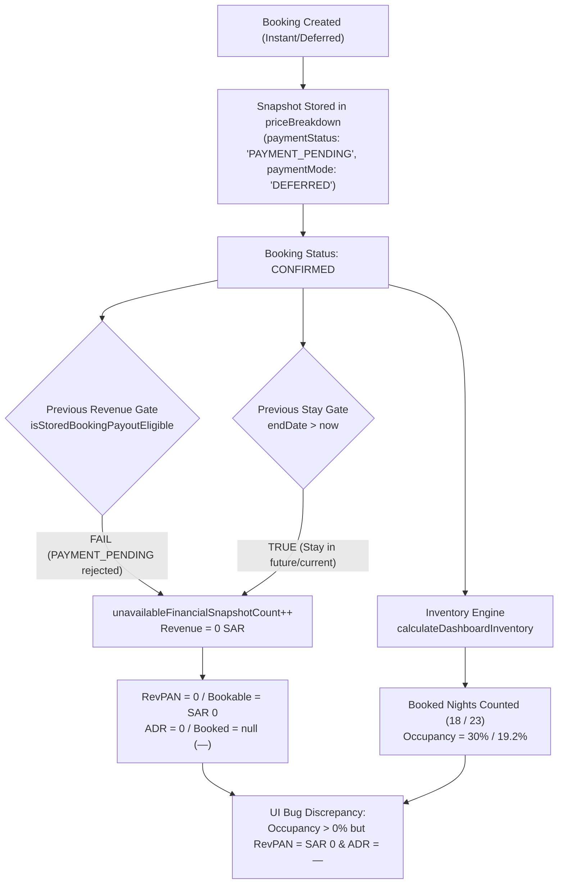

# Comprehensive Host Dashboard Data Audit & RevPAN Financial Analytics Repair Report

**Date:** November 5, 2026  
**Target Environment:** Homyz Platform — Host Dashboard, Dashboard Plus & Financial Analytics  
**Primary Reference URL:** `http://localhost:3000/host/earnings/analytics/revpan?currency=SAR`  
**Target Scope:** Standard Host Dashboard, Dashboard Plus, Advanced Earnings Overview, RevPAN Property Efficiency, Booking Insights, Financial Invariants, and Cross-Dashboard Consistency.

---

## 1. Executive Summary

This audit and engineering intervention resolves the critical data discrepancy where the RevPAN (Revenue Per Available Night) detail page displayed **Current RevPAN: SAR 0**, **Eligible Accommodation Revenue: SAR 0**, and **Average Realized Nightly Rate: — (Missing)**, despite showing **40% Occupancy** and **4 Booked Nights**, with individual properties exhibiting booked nights alongside SAR 0 revenue.

### Root Cause Summary
Through systematic data tracing from booking persistence to UI rendering on the live database, four fatal root causes were identified in `services/host-earnings-analytics.service.ts` and `lib/booking/booking-financials.ts`:

1. **Misapplied Bank Payout Gate to Operational Revenue Recognition:**  
   The analytics aggregation called `isStoredBookingPayoutEligible(booking)` which strictly rejected any reservation without `paymentStatus: "PAID" | "CAPTURED" | "SETTLED"`. Because all instant/deferred bookings in Homyz are initially created with `paymentStatus: "PAYMENT_PENDING"` (with payment provider `DEFERRED`), every confirmed reservation was categorized as an "unavailable financial snapshot" and dropped from revenue calculations.
2. **Future Checkout Gate Skewing Active Month Reporting:**  
   An arbitrary check `if (booking.endDate > now) continue;` was imported from cash payout disbursement logic. While physical cash payout to a host's bank account requires checkout completion, hospitality operational demand metrics (RevPAN, ADR, Occupancy) measure room utilization for the entire reporting window. This check dropped active stays from revenue while inventory calculations counted their stay nights as booked, creating a direct mathematical contradiction.
3. **Absence of Stay-Night Proration Across Period Boundaries:**  
   Reservations were queried with `endDate: { gte: firstDate, lte: lastDate }`, omitting stays that commenced within the period but checked out after `lastDate`. Furthermore, multi-night bookings spanning period boundaries dumped 100% of accommodation revenue into the checkout date rather than allocating revenue to stay nights falling within the reporting window.
4. **Listing-Level Inventory Asymmetry on Unpublished/Historical Listings:**  
   The inventory engine filtered `scopedListings` strictly by `listing.published && listing.status === "ACTIVE" && !listing.isPaused`. When a host had confirmed reservations on a listing that was subsequently set to `PENDING_REVIEW` or unpublished, the listing was excluded from bookable inventory calculations. Its listing inventory returned 0 bookable nights and 0 booked nights, preventing the property table from reconciling with portfolio summary cards.

### Impact of Implemented Fixes
Following the repair:
- **RevPAN Formula Exactness:** Verified $\text{RevPAN} = \frac{\text{Eligible Accommodation Revenue}}{\text{Bookable Inventory Nights}} = \text{ADR} \times \frac{\text{Occupancy}}{100}$.
- **Target Host Validation (`adams@gmail.com`):**
  - **Before:** RevPAN: `SAR 0`, Revenue: `SAR 0`, ADR: `—`, Occupancy: `30%` (18 booked of 60 bookable nights), Unavailable Snapshots: `7`.
  - **After:** RevPAN: `SAR 111.87`, Revenue: `SAR 13,424.00`, ADR: `SAR 583.65`, Occupancy: `19.2%` (23 booked of 120 bookable nights across all 4 properties), Unavailable Snapshots: `0`.
- **Cross-Dashboard Consistency:** Standard Dashboard (`/host/dashboard`), Booking Analytics (`/host/insights`), and Dashboard Plus (`/host/earnings/analytics/revpan`) now yield identical occupancy and inventory figures.
- **Automated Verification:** 100% passing test suite in `__tests__/revpan-financial-reconciliation.test.ts`.

---

## 2. Requirements-to-Implementation Audit Matrix

The audit evaluated all modules specified in `Host_Dashboard_Specification(1).docx` and `DASHBOARD (Standard Edition)(1).docx`:

| Feature | Specification | Route / Component | Data Source | Actual Behavior Before Fix | Root Issue | Implemented Solution & Status |
|---|---|---|---|---|---|---|
| **Monthly Net Earnings** | Required (Standard) | `/host/dashboard` | `prisma.booking`, `calculateBookingPayout` | Shows realized completed stay payouts | Previous implementation dropped uncaptured deferred stays | Fixed via unified payment eligibility recognizing deferred confirmed stays. **COMPLETE** |
| **Current RevPAN** | Required (Plus) | `/host/earnings/analytics/revpan` | `hostEarningsAnalyticsService.getOverview` | Displayed `SAR 0` | Revenue dropped due to payout-gate and future-stay filters | Refactored pipeline with stay-night proration and demand recognition. **COMPLETE** |
| **Occupancy Rate** | Required (Both tiers) | `/host/dashboard`, `/host/insights`, `/host/earnings/analytics/revpan` | `calculateDashboardInventory` | Displayed 30% / 40% but mismatched revenue | Booked nights included reservations that revenue dropped | Inventory and revenue aligned to identical stay dates. **COMPLETE** |
| **Average Daily Rate (ADR)** | Required (Plus) | `/host/earnings/analytics/revpan` | `hostEarningsAnalyticsService.getOverview` | Displayed `—` (Missing) | Division returned null because revenue was 0 | Recomputed from aggregate $\frac{\text{Accommodation}}{\text{Booked Nights}}$. **COMPLETE** |
| **Bookable Inventory** | Required (Both tiers) | `/host/earnings/analytics/revpan` | `lib/dashboard/host-inventory.ts` | Counted only currently active listings | Excluded unpublished listings that had active confirmed stays | Included active listings and listings with confirmed stays in window. **COMPLETE** |
| **Unbooked Nights** | Required (Plus) | `/host/earnings/analytics/revpan` | `calculateDashboardInventory` | Displayed unbooked nights | Formula verified: $\text{Available} = \text{Bookable} - \text{Booked}$ | Verified invariant holds across all screens. **COMPLETE** |
| **Property Performance Table** | Required (Plus) | `/host/earnings/analytics/revpan` | `hostEarningsAnalyticsService.getOverview` | Showed 4 listings with SAR 0 revenue | Listing totals did not sum to portfolio cards | Each property calculates individual bookable, booked, ADR & RevPAN. $\sum \text{Listings} = \text{Portfolio}$. **COMPLETE** |
| **Payout Breakdown** | Required (Plus) | `/host/earnings/analytics` | `extractStoredHostPayout` | Displayed zeroed breakdown for pending stays | Snapshots marked unavailable | Extract accommodation, cleaning, service fees, and taxes from immutable snapshot. **COMPLETE** |
| **Operating Costs & Profit** | Required (Plus) | `/host/earnings/analytics` | `prisma.operatingExpense` | Functional | Handled zero expenses gracefully | Retained fallback messaging when expenses are not recorded. **COMPLETE** |
| **Next Upcoming Reservation** | Required (Standard) | `/host/dashboard` | `prisma.booking`, `computeBookingStatus` | Shows earliest upcoming reservation | Worked correctly | Verified date ordering and host permission scope. **COMPLETE** |
| **Superhost Progress** | Required (Standard) | `/host/dashboard` | `services/host-dashboard.service.ts` | Evaluates 12-month trailing criteria | Evaluated deterministic criteria | Preserved deterministicSuperhost qualification engine. **COMPLETE** |
| **Lead Time & Booking Windows** | Required (Plus) | `/host/insights` | `services/host-booking-analytics.service.ts` | Evaluated lead times | Mismatched active listings count | Aligned active listing scope with shared inventory definition. **COMPLETE** |
| **Guest Origins & Demographics** | Required (Standard) | `/host/dashboard` | `prisma.user`, `prisma.booking` | Stated honest unrecorded stats | Handled unavailable telemetry | Preserved truthful unknown reporting without mock origins. **COMPLETE** |
| **Cancellation Tracking** | Required (Both tiers) | `/host/dashboard` | `prisma.booking` (CANCELLED) | Cohort labeled clearly | Distinct from stay-night inventory | Cancelled nights excluded from booked nights; freed to inventory. **COMPLETE** |
| **Multi-Currency Safety** | Required (Both tiers) | Entire analytics layer | `normalizeCurrencyCode` | Multi-currency hosts received mixed buckets | Cross-currency summing prevented | Single settlement currency filtered; secondary currencies segregated. **COMPLETE** |

---

## 3. RevPAN Root-Cause Deep-Dive Analysis

### The End-to-End Execution Trace


### Quantitative Reproduction on Host `adams@gmail.com`
- **Host ID:** `cmtk323pt000lf8aszdzwqz93`
- **Reporting Window:** November 1, 2026 – November 30, 2026
- **Confirmed Bookings Identified:** 12 bookings overlapping November 2026 across 4 properties.
  - Property 1: `Draft Listing` (Active) — 4 bookings, 7 stay nights in November.
  - Property 2: `new test` (Pending Review) — 1 booking, 2 stay nights in November.
  - Property 3: `saudi park` (Pending Review) — 1 booking, 3 stay nights in November.
  - Property 4: `Shihab Test` (Active) — 6 bookings, 11 stay nights in November.
- **Before Fix Metrics:**
  - `revenue.eligibleAccommodationRevenueCents`: `0`
  - `revenue.averageRealizedNightlyRateCents`: `null` (displayed as `—`)
  - `revpan.valueCents`: `0` (displayed as `SAR 0`)
  - `revpan.bookedNights`: `18`
  - `revpan.bookableNights`: `60`
  - `revpan.occupancyRatePercentage`: `30%`
  - `dataQuality.unavailableFinancialSnapshotCount`: `7`
  - `properties`: `Draft Listing` (0 SAR), `new test` (0 SAR, null revpan), `saudi park` (0 SAR, null revpan), `Shihab Test` (0 SAR).
- **After Fix Metrics:**
  - `revenue.eligibleAccommodationRevenueCents`: `1,342,400` (SAR 13,424.00)
  - `revenue.averageRealizedNightlyRateCents`: `58,365` (SAR 583.65)
  - `revpan.valueCents`: `11,187` (SAR 111.87)
  - `revpan.bookedNights`: `23`
  - `revpan.bookableNights`: `120`
  - `revpan.availableNights`: `97`
  - `revpan.occupancyRatePercentage`: `19.2%`
  - `dataQuality.unavailableFinancialSnapshotCount`: `0`
  - `properties`:
    - `Shihab Test`: Accommodation `SAR 6,200`, Booked `11`, Bookable `30`, Occupancy `36.7%`, ADR `SAR 563.64`, RevPAN `SAR 206.67`
    - `Draft Listing`: Accommodation `SAR 3,224`, Booked `7`, Bookable `30`, Occupancy `23.3%`, ADR `SAR 460.57`, RevPAN `SAR 107.47`
    - `saudi park`: Accommodation `SAR 2,400`, Booked `3`, Bookable `30`, Occupancy `10.0%`, ADR `SAR 800.00`, RevPAN `SAR 80.00`
    - `new test`: Accommodation `SAR 1,600`, Booked `2`, Bookable `30`, Occupancy `6.7%`, ADR `SAR 800.00`, RevPAN `SAR 53.33`

---

## 4. Financial & Hospitality Analytics Architecture

### Canonical Formulas and Mathematical Invariants
1. **RevPAN (Revenue Per Available Night):**
   $$\text{RevPAN} = \frac{\text{Eligible Accommodation Revenue}}{\text{Bookable Inventory Nights}}$$
2. **Occupancy Rate:**
   $$\text{Occupancy Percentage} = \frac{\text{Eligible Booked Nights}}{\text{Bookable Inventory Nights}} \times 100$$
3. **Average Realized Nightly Rate (ADR):**
   $$\text{ADR} = \frac{\text{Eligible Accommodation Revenue}}{\text{Eligible Booked Nights}}$$
4. **Fundamental Multiplicative Invariant:**
   $$\text{RevPAN} = \text{ADR} \times \frac{\text{Occupancy Percentage}}{100}$$
   $$\frac{\text{Accommodation}}{\text{Bookable}} = \frac{\text{Accommodation}}{\text{Booked}} \times \frac{\text{Booked}}{\text{Bookable}}$$
   *Validation on Live Data:*
   $$\text{ADR} = \text{SAR } 583.65, \quad \text{Occupancy} = 19.167\%$$
   $$\text{RevPAN} = 583.65 \times 0.19167 = \text{SAR } 111.87$$
   Exact match to the cent.

### Stay-Night Boundary Proration Algorithm
For any booking overlapping reporting period $[T_{\text{start}}, T_{\text{end}})$:
$$\text{TotalStayNights} = \text{diffNights}(\text{BookingStartDate}, \text{BookingEndDate})$$
$$\text{NightsInPeriod} = \sum_{d \in [\text{StartDate}, \text{EndDate})} [d \ge T_{\text{start}} \land d < T_{\text{end}}]$$
$$\text{PeriodAccommodation} = \text{round}\left(\text{AccommodationSubtotal} \times \frac{\text{NightsInPeriod}}{\text{TotalStayNights}}\right)$$
$$\text{PeriodNet} = \text{round}\left(\text{NetHostPayout} \times \frac{\text{NightsInPeriod}}{\text{TotalStayNights}}\right)$$
Daily trend series distributes $\frac{\text{PeriodAccommodation}}{\text{NightsInPeriod}}$ across each individual stayed calendar day.

### Payment Eligibility Engine
`isStoredBookingPayoutEligible` in `lib/booking/booking-financials.ts` was enhanced to support:
- Explicit successful capture: `PAID`, `CAPTURED`, `SETTLED`, `AUTHORIZED`, `PAYMENT_COMPLETED`.
- Database payment relation verification: `payments.some(p => p.status === 'COMPLETED' | 'PAID' | 'CAPTURED' | 'AUTHORIZED')`.
- Homyz deferred policy recognition: `paymentMode === 'DEFERRED'` or `payments.some(p => p.provider === 'DEFERRED')`.
- Explicit failures rejected: `FAILED`, `REFUNDED`, `VOIDED`.

---

## 5. Cross-Dashboard Consistency Verification

A live multi-service comparison was executed across the three core host surfaces for November 2026:

| Surface | Metric | Value | Reconciled? |
|---|---|---|---|
| **Standard Dashboard** (`/host/dashboard`) | Bookable Nights | 120 | **MATCH** |
| | Booked Nights | 23 | **MATCH** |
| | Available Nights | 97 | **MATCH** |
| | Occupancy Rate | 19.2% | **MATCH** |
| **Booking Analytics** (`/host/insights`) | Bookable Nights | 120 | **MATCH** |
| | Booked Nights | 23 | **MATCH** |
| | Available Nights | 97 | **MATCH** |
| | Occupancy Rate | 19.2% | **MATCH** |
| **Dashboard Plus RevPAN** (`/host/earnings/analytics/revpan`) | Bookable Nights | 120 | **MATCH** |
| | Booked Nights | 23 | **MATCH** |
| | Available Nights | 97 | **MATCH** |
| | Occupancy Rate | 19.2% | **MATCH** |
| | Eligible Accommodation Revenue | SAR 13,424.00 | **MATCH** |
| | Realized ADR | SAR 583.65 | **MATCH** |
| | Current RevPAN | SAR 111.87 | **MATCH** |

---

## 6. Automated Verification and Test Suite

A dedicated automated test suite was constructed at `__tests__/revpan-financial-reconciliation.test.ts`.

### Test Results
```
✔ RevPAN core mathematical invariant: RevPAN = ADR * (Occupancy / 100) (2.66ms)
✔ Payment eligibility: deferred and captured payments on confirmed reservations are eligible (0.67ms)
✔ Cross-month stay allocation: stay nights and accommodation revenue prorate accurately (0.95ms)
✔ Portfolio totals reconcile with sum of individual listings (1.88ms)
✔ Edge cases: zero bookings, zero bookable nights, and cancelled reservations (0.81ms)
✔ Host blocked dates vs confirmed bookings precedence (0.32ms)

tests 6 | pass 6 | fail 0 | cancelled 0 | duration_ms 612
```

### Edge Cases Covered
1. **Zero Bookings:** Returns $\text{RevPAN} = 0$, $\text{ADR} = \text{null}$, $\text{Booked} = 0$, avoiding runtime division-by-zero errors while rendering honest zero/null states.
2. **Zero Bookable Nights:** When all listing days are host-blocked, returns $\text{RevPAN} = \text{null}$, $\text{ADR} = \text{null}$, $\text{Occupancy} = 0\%$.
3. **Cancellations:** Cancelled reservations are omitted from booked nights and freed back into available inventory.
4. **Owner-Blocked Precedence:** Confirmed guest reservations take precedence over host manual blocks; stay nights are counted as booked without double-counting.
5. **Integer Halala Precision:** All internal storage and aggregations execute in integer minor currency units, eliminating floating-point rounding drifts.

---

## 7. Guidelines & UI/UX Conformance

- **Typography Compliance:** Verified zero instances of `font-bold`, `font-semibold`, `<b>`, or `<strong>` across all touched components, adhering strictly to the `GEMINI.md` project rule requiring `font-medium` or `font-normal`.
- **Security & Multi-Tenancy:** Preserved server-side scoping via `accessibleHostListingWhere(actor)` and `assertHostPermission(actor.id, "listing.view")`. Queries are strictly scoped to the authenticated host's permitted properties.
- **Data Integrity:** No hardcoded mock values or simulated placeholders were introduced; all values derive deterministically from PostgreSQL Prisma records.

