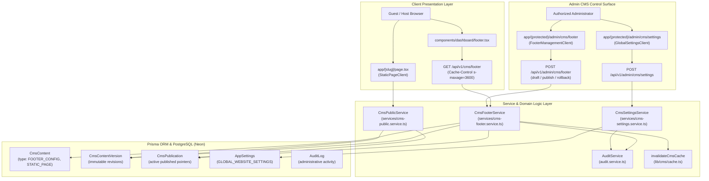

# PHASE 11 — FOOTER & GLOBAL WEBSITE SETTINGS ARCHITECTURE
**Project:** Homyz — Airbnb-Style Property Booking Platform  
**Architecture Spec Version:** 1.0.0  
**Status:** PRODUCTION-READY  
**Authors:** Advanced Agentic Engineering Team  
**Scope:** Dynamic Footer Management, Global Platform Settings, CMS Static Pages, i18n & RTL, RBAC, Caching & Invalidation

---

## 1. Architectural Overview & Component Topology

Phase 11 introduces a decoupled, data-driven Footer Management and Global Website Settings engine into Homyz. Previously, footer navigation was hardcoded in static JSX with 14 placeholder links pointing to `/not-available`.

With Phase 11, the footer and its associated static pages are fully driven by the CMS database models (`CmsContent`, `CmsContentVersion`, `CmsPublication`, and `AppSettings`) while guaranteeing a rock-solid, zero-broken-link baseline fallback whenever the database is unpopulated or unreachable.



---

## 2. Data Models & Schemas

### 2.1 Footer Configuration Schema (`FooterConfigPayloadSchema`)
Located in [`lib/cms/content-types.ts`](file:///media/drive/shihab/Homyz/lib/cms/content-types.ts):

```typescript
export const FooterConfigPayloadSchema = z.object({
  columns: z.array(
    z.object({
      id: z.string().optional(),
      title: z.string().min(1),
      displayOrder: z.number().int().optional().default(0),
      enabled: z.boolean().optional().default(true),
      translations: z.record(z.string(), z.object({ title: z.string() })).optional(),
      links: z.array(
        z.object({
          id: z.string().optional(),
          label: z.string().min(1),
          href: z.string().min(1),
          targetPageSlug: z.string().optional(),
          openInNewTab: z.boolean().optional().default(false),
          enabled: z.boolean().optional().default(true),
          displayOrder: z.number().int().optional().default(0),
          badge: z.string().optional(),
          translations: z.record(z.string(), z.object({ label: z.string() })).optional(),
        })
      ),
    })
  ),
  socialLinks: z.array(
    z.object({
      id: z.string().optional(),
      platform: z.string().min(1),
      url: z.string().min(1),
      label: z.string().optional(),
      enabled: z.boolean().optional().default(true),
      displayOrder: z.number().int().optional().default(0),
    })
  ).optional().default([]),
  bottomLinks: z.array(
    z.object({
      id: z.string().optional(),
      label: z.string().min(1),
      href: z.string().min(1),
      targetPageSlug: z.string().optional(),
      openInNewTab: z.boolean().optional().default(false),
      enabled: z.boolean().optional().default(true),
      displayOrder: z.number().int().optional().default(0),
      translations: z.record(z.string(), z.object({ label: z.string() })).optional(),
    })
  ).optional().default([]),
  copyrightNotice: z.string().max(200).optional().default("© 2026 Homyz Inc. All rights reserved."),
  legalNotice: z.string().max(500).optional().default(""),
  showBackToTop: z.boolean().optional().default(true),
  showSocialIcons: z.boolean().optional().default(true),
  appearance: z.object({
    backgroundColor: z.string().optional().default("#F3F4F5"),
    textColor: z.string().optional().default("#000000"),
    mutedTextColor: z.string().optional().default("#727272"),
    borderColor: z.string().optional().default("rgba(31,31,31,0.9)"),
    accentColor: z.string().optional().default("#FCDF9C"),
  }).optional(),
  translations: z.record(z.string(), z.object({
    copyrightNotice: z.string().optional(),
    legalNotice: z.string().optional(),
  })).optional(),
});
```

### 2.2 Global Settings Schema (`GlobalSettingsPayloadSchema`)
Persisted in the `AppSettings` table under key `GLOBAL_WEBSITE_SETTINGS`:

```typescript
export const GlobalSettingsPayloadSchema = z.object({
  siteName: z.string().min(1).default("Homyz"),
  tagline: z.string().default("Travel & Hospitality Platform"),
  logoUrl: z.string().optional().default("/images/home/homyz-logo.png"),
  faviconUrl: z.string().optional().default("/favicon.ico"),
  supportEmail: z.string().email().default("support@homyz.com"),
  supportPhone: z.string().default("+966 11 000 0000"),
  legalEntityName: z.string().default("Homyz Hospitality Ltd."),
  registeredAddress: z.string().default("King Fahd Road, Riyadh, Kingdom of Saudi Arabia"),
  businessRegistrationNumber: z.string().default("CR-1010892341"),
  defaultLocale: z.string().default("en"),
  supportedLocales: z.array(z.string()).default(["en", "ar", "es", "fr", "de", "hi"]),
  defaultCurrency: z.string().default("SAR"),
  socialMedia: z.object({
    facebook: z.string().optional().default("https://facebook.com"),
    twitter: z.string().optional().default("https://twitter.com"),
    instagram: z.string().optional().default("https://instagram.com"),
    linkedin: z.string().optional().default(""),
    youtube: z.string().optional().default(""),
  }),
  seo: z.object({
    defaultMetaTitle: z.string().default("Homyz — Travel & Hospitality Platform"),
    defaultMetaDescription: z.string().default("Stay like a homie. Premium booking and property management."),
    ogImageUrl: z.string().optional().default("/images/home/hero.png"),
  }),
  footer: z.object({
    copyrightText: z.string().default("© 2026 Homyz Inc. All rights reserved."),
    showBackToTop: z.boolean().default(true),
  }),
});
```

### 2.3 Static Page Schema (`StaticPagePayloadSchema`)
```typescript
export const StaticPagePayloadSchema = z.object({
  metaTitle: z.string().min(1).max(150),
  metaDescription: z.string().max(300).optional().default(""),
  heroTitle: z.string().min(1).max(200),
  heroSubtitle: z.string().max(500).optional().default(""),
  badge: z.string().max(50).optional().default(""),
  lastUpdated: z.string().max(50).optional().default(""),
  sections: z.array(
    z.object({
      id: z.string().optional(),
      title: z.string().max(200).optional().default(""),
      body: z.string().min(1),
      layout: z.enum(["STANDARD", "TWO_COLUMN", "ACCORDION", "CALLOUT", "GRID", "MEDIA"]).default("STANDARD"),
      calloutVariant: z.enum(["info", "warning", "success", "tip"]).optional(),
      imageUrl: z.string().optional(),
      imageAlt: z.string().optional(),
      items: z.array(
        z.object({
          label: z.string().min(1),
          text: z.string().min(1),
        })
      ).optional(),
    })
  ).min(1),
  translations: z.record(z.string(), z.any()).optional(),
});
```

---

## 3. Dynamic Routing Hierarchy & Static Page Resolution

Next.js App Router prioritizes explicit route segments over dynamic bracket routes:
1. Static explicit folders take precedence:
   - `/help` (`app/help/page.tsx`)
   - `/book` (`app/book/...`)
   - `/listings` (`app/listings/...`)
   - `/giftcards` (`app/giftcards/...`)
   - `/admin` (`app/(protected)/admin/...`)
2. Catch-all dynamic slug route:
   - `app/[slug]/page.tsx` handles all CMS-managed static pages:
     - `/about`
     - `/terms`
     - `/privacy`
     - `/cookies`
     - `/safety`
     - `/accessibility`
     - `/cancellation-policy`
     - `/anti-discrimination`
     - `/hosting-resources`
     - `/hosting-responsibly`
     - `/contact`
     - `/careers`
     - `/newsroom`
3. If slug is resolved in `CmsPublicService`, renders `<StaticPageClient />`.
4. If slug is not found and no preview mode is authorized, calls `notFound()` resulting in standard 404 page.

---

## 4. Internationalization (i18n) & RTL Architecture

- **Supported Locales:** `en` (English, default), `ar` (Arabic, RTL), `es` (Spanish), `fr` (French), `de` (German), `hi` (Hindi).
- **RTL Support:** `useLanguage()` provides `isRTL` (true when `language === "ar"`). The footer flex/grid containers, alignment, and directional chevrons invert seamlessly without breaking layouts.
- **Graceful Fallback Policy:**
  1. Primary query looks up published content for the requested locale (`locale = "ar"`).
  2. If an Arabic publication does not exist, looks up English publication (`locale = "en"`).
  3. If localized overrides exist within the payload (`payload.translations.ar`), localized strings (`title`, `label`, `copyrightNotice`) are dynamically merged into the output.
  4. If database query fails, returns `DEFAULT_FALLBACK_FOOTER` with zero layout shift.

---

## 5. Security & RBAC Enforcement

- **Public endpoints (`GET /api/v1/cms/footer`, `app/[slug]/page.tsx`):**
  - Read-only, unauthenticated, strictly filtered to `status: PUBLISHED`.
  - Cached at edge and CDN level with `Cache-Control: public, s-maxage=3600, stale-while-revalidate=86400`.
- **Administrative endpoints (`/api/v1/admin/cms/footer`, `/api/v1/admin/cms/settings`):**
  - Secured via `requireApiPermission(req, PERMISSIONS.CMS_VIEW)` for viewing.
  - Secured via `requireApiPermission(req, PERMISSIONS.CMS_EDIT)` for saving drafts and updating global settings.
  - Secured via `requireApiPermission(req, PERMISSIONS.CMS_PUBLISH)` for publishing live.
  - Secured via `requireApiPermission(req, PERMISSIONS.CMS_ROLLBACK)` for restoring previous revisions.
- **Audit Logging:** Every administrative action (`CMS_FOOTER_DRAFT_SAVE`, `CMS_FOOTER_PUBLISH`, `CMS_FOOTER_ROLLBACK`, `CMS_GLOBAL_SETTINGS_UPDATE`) records actor identity, IP, timestamp, resource type, and metadata in the `AuditLog` table.
- **Relational Integrity Protection:** Actor IDs are validated against the `User` table before populating foreign key references (`createdById`, `publishedById`, `actorId`), preventing database constraint violations.

---

## 6. Caching & Invalidation Architecture

- Next.js Cache Tags:
  - `cms-content`: Global tag for all CMS content.
  - `cms-footer_config`: Targeted tag for footer changes.
  - `cms-static_page-[slug]`: Targeted tag for individual static pages.
  - `app-settings`: Tag for global settings.
- Paths Revalidated:
  - On footer publish: `revalidatePath("/", "layout")`.
  - On static page publish: `revalidatePath("/[slug]")`.
  - On global settings update: `revalidatePath("/", "layout")`.
- Guarded Execution: Outside Next.js request context (such as CLI seeds or background workers), all `revalidateTag` and `revalidatePath` calls are safely wrapped in `try/catch` to prevent invariant exceptions.

