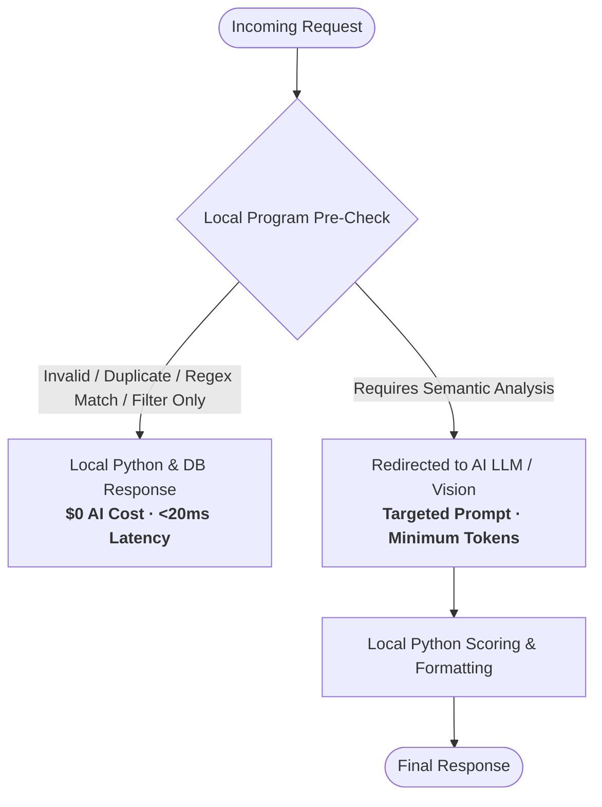

# Workload Distribution & AI Bypass Architecture

> **Authoritative Technical Specification**: This document details the engineering distribution between local deterministic computation (Python, OpenCV, ImageHash, Qdrant HNSW vector indexes) and external AI models (OpenAI / Google Gemini LLM & Vision). It outlines the exact conditions under which external AI calls are completely short-circuited and bypassed ($0 cost, 0ms AI latency).

---

## 1. Architectural Philosophy: The "Local-First / Deterministic-Shield" Pattern

To maximize execution throughput, minimize operational expenditure, and protect against latency spikes, our microservice implements a **Deterministic Shield** pattern:

1. **Local Deterministic Work First**: Algorithmic rules, regex scans, image processing matrices, spatial database queries, and mathematical scoring are always executed locally in Python and Qdrant at **$0 AI cost** and **<25ms latency**.
2. **AI Short-Circuiting (Bypass Gates)**: If an incoming payload fails local validation, is identified as a duplicate/corrupt asset, triggers a Tier-0 security or fraud violation, or lacks free-text search criteria, the external AI call is **completely aborted**.
3. **Targeted AI Dispatch**: External AI models (LLM / Multimodal Vision / Embeddings) are invoked strictly when genuine semantic reasoning, qualitative visual aesthetics, or human-like language synthesis is required.

---

## 2. Granular Module-by-Module Workload Breakdown

### 2.1 Module 1: Search & Ranking Engine
*Code Reference: `app/services/search_service.py` & `app/services/listing_service.py`*

#### Work Performed Locally (Python & Qdrant)
- **Spatial Geo-Bounding Filter**: Mathematical `geo_radius` query filtering listings within $X$ km of `(lat, lon)` using Qdrant's indexed payload.
- **Structured Attribute Filtering**: Strict numeric ranges for nightly price (`min_price`, `max_price`), guest capacity (`guests`), and exact city match.
- **Behavioral Personalization**: Calls Qdrant's internal HNSW `recommend` API (`positive_listing_ids`, `negative_listing_ids`) to perform vector space centroid calculations on user browsing history with **0 LLM tokens**.
- **Fair Discovery Boost Slotting**: Algorithmic re-ranking injecting newly published listings into strategic Page 1 positions (slots 4 and 9) if they meet the relevance threshold.
- **Search Metadata Formulation**: Concatenates title, property type, location, and amenities into a dense vector document, excluding noisy descriptions.

#### Work Redirected to AI
- **Query Embedding Generation**: Converts unstructured natural language queries (e.g., *"quiet mountain cabin with fast wifi"*) into a 1536-dimensional vector via `text-embedding-3-small`.
- **Listing Sync Embedding Generation**: Embeds the concise search text representation once upon listing creation or update.

#### Conditions Where AI is Completely Bypassed ($0 Cost)
1. **Filter-Only Searches**: When a traveler browses by map coordinates, city, dates, price range, or guest capacity without entering a text query (`request.query` is null or empty). The entire search runs directly against Qdrant database payload indexes.
2. **Quarantined Listings on Sync**: If a listing is flagged as fraudulent during the pre-sync risk audit, embedding generation is completely aborted and the listing is never indexed.

---

### 2.2 Module 2: Photo Categorization & Quality Scoring
*Code Reference: `app/services/photo_service.py`*

#### Work Performed Locally (Python, OpenCV, Pillow, ImageHash)
- **Concurrent Asset Ingestion**: Concurrent downloads bound by an asynchronous semaphore, enforcing a 15MB file size limit and a 15-second timeout.
- **Image Integrity & Decompression Guard**: Pillow stream verification and 50-megapixel decompression bomb safety limit.
- **Laplacian Variance Blur Calculation**: Computes `cv2.Laplacian(gray_matrix, cv2.CV_64F).var()` to mathematically detect camera defocus or motion blur.
- **Luminance & Exposure Histograms**: Computes mean grayscale pixel brightness to detect pitch-black, underexposed, or overexposed images.
- **Aspect Ratio Validation**: Checks dimensional ratio to flag extreme panoramic or vertical letterbox distortion.
- **Batch Perceptual Hashing (pHash)**: Computes 64-bit perceptual image hashes and calculates pairwise Hamming distances (`abs(phash1 - phash2) <= 6`) across the batch to catch near-identical photos taken seconds apart.
- **Smart Cover Photo Hierarchy**: Deterministic algorithmic selector:
  - *Tier 1*: Living Room or Exterior/Entrance with aesthetic score $\ge 7.0$.
  - *Tier 2*: Bedroom, Balcony/Patio, or Amenities/Pool with aesthetic score $\ge 7.0$.
  - *Tier 3*: Highest scoring qualified space (strictly excluding Bathrooms and non-property spaces).
- **Room Grouping**: Organizes validated photos into structured room clusters.

#### Work Redirected to AI (Multimodal Vision LLM)
- Evaluates genuine, non-duplicate, non-corrupt photos using `gpt-4o-mini` (Vision):
  - Classifies room category (`Living Room`, `Bedroom`, `Kitchen`, `Bathroom`, `Balcony/Patio`, `Dining Room`, `Exterior/Entrance`, `Amenities/Pool`).
  - Relevance verification: Distinguishes genuine accommodation rooms from documents, screenshots, memes, receipts, or personal selfies.
  - Qualitative composition and lighting balance ratings (1–10).
  - Generates concise, host-actionable improvement suggestions.

#### Conditions Where AI is Completely Bypassed ($0 Cost)
1. **Download Failure / HTTP Errors**: URL unreachable or network failure; AI bypassed.
2. **File Size Over Limit**: Images exceeding 15MB are immediately rejected; AI bypassed.
3. **Corrupt or Unreadable Format**: Fails Pillow decode/verify; AI bypassed.
4. **Perceptual Near-Duplicates**: If a photo matches an earlier photo in the batch (`Hamming distance <= 6`), it is marked as duplicate and AI vision is bypassed.
5. **Pitch-Black / Severely Underexposed Photos**: Mean brightness $< 15.0$; marked as underexposed and AI vision is bypassed.

---

### 2.3 Module 3: Review Moderation & Summarization
*Code Reference: `app/services/review_service.py`*

#### Work Performed Locally (Python Standard Library & Regex)
- **Text Normalization**: Unicode NFKC normalization and whitespace collapse.
- **Tier-0 Deterministic Regex Pre-Screening**: High-throughput compiled regular expressions matching:
  - Direct telephone numbers and spaced digits.
  - Email addresses (including obfuscated `[at]` / `[dot]` patterns).
  - Messaging handles (WhatsApp `wa.me`, Telegram `t.me`, Signal).
  - Social handles and payment platforms (PayPal, CashApp, Venmo, Wire Transfer).
  - Physical security credentials (door keypad pins, lockbox combinations, alarm codes).
- **Review Deduplication**: Normalizes and deduplicates identical reviews in summarization batches.
- **Review Volume & Density Classification**: Evaluates word counts and review volume to automatically switch between `ultra-sparse` mode ($\le 2$ reviews or $<30$ words) and `standard` synthesis mode.
- **Rating Clamping**: Enforces strict mathematical bounds $[1.0, 5.0]$ rounded to 1 decimal place.

#### Work Redirected to AI (LLM)
- **Content Moderation (`omni-moderation-latest` / `gpt-4o-mini`)**: Evaluates clean reviews for nuanced personal harassment, hate speech, severe profanity, conditional extortion ("refund me in full or I leave 1 star"), and host-guest blackmail, while preserving honest negative feedback (anti-censorship guarantee).
- **Aspect Extraction & Summarization (`gpt-4o-mini`)**: Extracts ratings for Cleanliness, Accuracy, Check-in, Communication, Location, and Value on a 1.0–5.0 scale, detects sarcasm/irony, and generates balanced narrative highlights and considerations in the target language.

#### Conditions Where AI is Completely Bypassed ($0 Cost)
1. **Star-Only / Empty Review Comments**: When a guest leaves a numerical star rating with an empty text body (`comment.strip() == ""`), the moderation gate approves it instantly without calling an AI model.
2. **Regex Contact / Door Code Violations**: If a review discloses off-platform contact vectors, payment solicitations, or private door entry pins, it is immediately rejected locally. No LLM tokens are consumed.

---

### 2.4 Module 4: Streaming Guest Support Chatbot
*Code Reference: `app/services/chat_service.py`*

#### Work Performed Locally (Python AsyncIO & Qdrant)
- **Point Lookup (RAG Context)**: Queries Qdrant directly by `listing_id` to retrieve ground-truth property metadata.
- **Zero-Knowledge Security Scrubbing**: Extracts public check-in hours, parking availability, and cancellation policies while **strictly scrubbing private Wi-Fi passwords, gate pins, and lockbox codes** before passing context to the LLM.
- **Sliding-Window History Pruning**: Truncates conversation history to the last 5 turns to eliminate prompt bloat and keep latency low.
- **Local Follow-Up Suggestion Generator**: Generates dynamic quick-reply suggestion chips using keyword classification (`cancel`, `refund`, `check-in`, `parking`, `wifi`) at **$0 cost** and **0ms latency**.
- **SSE Stream Formatting**: Packages text deltas into standard Server-Sent Events (`data: {"token": "..."}\n\n`).
- **Offline Fallback Handler**: Emits a friendly platform support redirect if the upstream LLM times out or encounters network degradation.

#### Work Redirected to AI (Streaming LLM)
- **Conversational Synthesis (`gpt-4o-mini`)**: Streams real-time, polite, and grounded answers adhering strictly to platform policies and property rules.

#### Conditions Where AI is Completely Bypassed ($0 Cost)
- While generating a conversational answer to a user question requires LLM streaming, **all suggested follow-up quick-reply chips are 100% computed locally** via Python keyword heuristics with zero extra LLM completion calls.

---

### 2.5 Module 5: Listing Scam & Fraud Risk Audit
*Code Reference: `app/services/risk_service.py` & `app/services/listing_service.py`*

#### Work Performed Locally (Python & Qdrant)
- **Tier-0 Deterministic Regex Scanner**: Scans titles, descriptions, and house rules across 4 languages (English, Arabic, French, Spanish) for wire transfers, Western Union, crypto, Zelle, CashApp, IBAN, bank transfer, and WhatsApp/phone permutations.
- **L33t-Speak Normalization**: Maps substitution symbols (`@` $\rightarrow$ `a`, `$` $\rightarrow$ `s`, `0` $\rightarrow$ `o`) prior to regex evaluation.
- **Negation Lookback Engine**: Inspects an 80-character preceding window to verify if payment phrases are negated (e.g., *"never pay outside Homyz"* or *"do not wire transfer"* will not cause false positives).
- **Tier-1 Spatial Price Anomaly Scanner**: Queries active listings in a 5km radius with matching guest capacity from Qdrant and computes the statistical median price (`statistics.median`).
- **Spatial Honeypot Scoring**: Flags prices $<25\%$ of neighborhood median (`EXTREME_PRICE_HONEYPOT`, +75 pts) and $<50\%$ of median (`PRICE_HONEYPOT`, +40 pts).
- **Composite Risk Scorer**: Aggregates signal weights, applies ceiling clamping $[0, 100]$, and assigns verdicts (`AUTO_APPROVE`, `WARNING_LOW_CONFIDENCE`, `FLAG_FOR_MANUAL_AUDIT`).
- **Dynamic Recommendation Engine**: Formulates contextual host and moderator advisory text matching the specific violations detected.

#### Work Redirected to AI (LLM)
- **Contextual Scam Analysis (`gpt-4o-mini`)**: Scans for deceptive narratives, remote host courier stories ("working abroad as a missionary, will mail keys via DHL"), high-pressure urgency tactics ("must book within 2 hours"), layout contradictions (claiming 8 bedrooms in a 400 sqft studio), and cold-start price honeypots (where 0 spatial neighbors exist).

#### Conditions Where AI is Completely Bypassed ($0 Cost)
- **Critical Fraud Short-Circuit**: If Tier-0 regex detects an explicit off-platform payment scam (e.g., Western Union / wire transfer) OR Tier-1 spatial detects an extreme price honeypot ($<25\%$ of neighborhood median), the listing is ALREADY guaranteed to be quarantined (`severity == CRITICAL`). **The AI LLM call is completely short-circuited and bypassed ($0 cost, 0 tokens)**.

---

## 3. Workload Distribution Matrix

| Feature / Module | Work Handled Locally by Program | Work Redirected to External AI | AI Bypass Scenarios ($0 Cost) |
| :--- | :--- | :--- | :--- |
| **Module 1: Search & Sync** | **~90%**: Geo-radius bounding, price/capacity filters, city matching, HNSW personalization, new listing boosting, pagination. | **~10%**: Query text embedding & new listing embedding (`text-embedding-3-small`). | • Map/filter searches without text query. • Quarantined fraud listings on sync. |
| **Module 2: Photo Quality** | **~60%**: Concurrency semaphore, download size limit, OpenCV blur variance, brightness histograms, pHash duplicate detection, cover photo ranking. | **~40%**: Room categorization, relevance verification, qualitative aesthetic scoring, host tips (`gpt-4o-mini` Vision). | • Corrupt or unreadable files. • Network download errors or $>15$MB. • Perceptual duplicate photos. • Pitch-black / underexposed photos. |
| **Module 3: Review Moderation** | **~50%**: Unicode NFKC normalization, door code regex, contact regex (phone, email, WhatsApp, crypto), sparsity heuristics, score clamping. | **~50%**: Semantic toxicity, harassment, extortion detection, aspect extraction, sarcasm detection (`gpt-4o-mini`). | • Star-only reviews with empty comments. • Reviews triggering contact or door code regex. |
| **Module 4: Guest Support Chat** | **~30%**: Qdrant property lookup, zero-knowledge credential scrubbing, 5-turn history pruning, dynamic quick-reply chips, SSE streaming. | **~70%**: Conversational token streaming and contextual answer synthesis (`gpt-4o-mini`). | • Quick-reply suggestion chips are 100% computed locally without extra LLM calls. |
| **Module 5: Risk & Scam Audit** | **~65%**: Multilingual payment regex, l33t speak normalization, negation engine, 5km spatial median pricing, composite scoring, recommendation text. | **~35%**: Deceptive storytelling, courier/missionary scams, urgency pressure, layout contradictions (`gpt-4o-mini`). | • Listings with Tier-0 regex payment scams. • Listings with Tier-1 spatial extreme price honeypots ($<25\%$ of median). |
