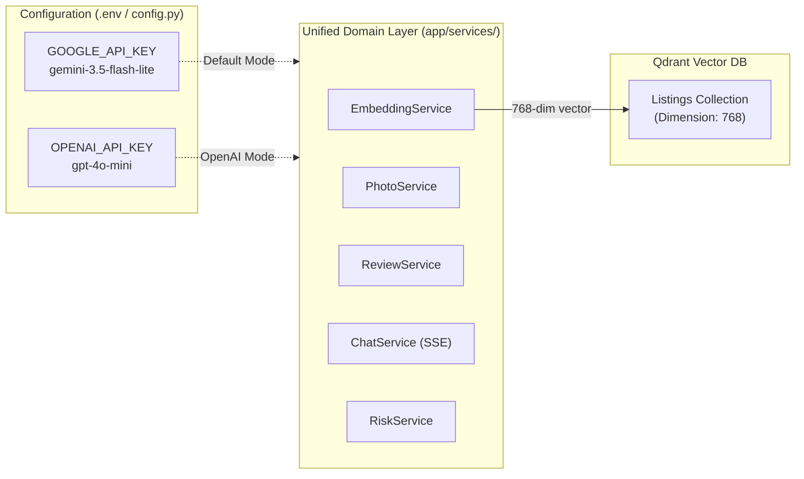

# LLM Provider Migration & Parity Guide: Google Gemini ⟷ OpenAI

> **Source of Truth for Provider Portability**: This document specifies all code modifications, configuration changes, error handling mappings, and vector dimension strategies required to switch the `homyz-ai-backend` between **Google Gemini** (current default) and **OpenAI**.
>
> **Maintenance Rule**: Whenever a new AI service, tool, or prompt is introduced or updated in `app/services/`, the author/agent must evaluate whether it functions identically under both providers and record any provider-specific adjustments in this document.

---

## 1. Migration Architecture & Strategy

The application is architected around the **Dual-Provider Parity Standard**: all business logic, schemas, and API contracts remain identical regardless of whether Gemini or OpenAI powers the backend.



---

## 2. Environment & Configuration Differences

### 2.1 Settings (`app/core/config.py`)

To switch to OpenAI, update `app/core/config.py`:

```python
# --- CURRENT (Google Gemini) ---
GOOGLE_API_KEY: str = ""
GEMINI_MODEL: str = "gemini-3.5-flash-lite"
GEMINI_EMBEDDING_MODEL: str = "models/text-embedding-004"
VECTOR_SIZE: int = 768

# --- OPENAI ALTERNATIVE ---
OPENAI_API_KEY: str = ""
OPENAI_MODEL: str = "gpt-4o-mini"
OPENAI_EMBEDDING_MODEL: str = "text-embedding-3-small"
VECTOR_SIZE: int = 768  # Using OpenAI's native dimensions=768 parameter
```

### 2.2 Local Environment (`app/.env` & `app/.example.env`)

```ini
# Gemini Configuration:
GOOGLE_API_KEY="AIzaSy..."

# OpenAI Configuration:
OPENAI_API_KEY="sk-proj-..."
```

---

## 3. Vector Database Dimension Strategy (Zero-Reindexing)

* **The Problem**: 
  * Gemini `models/text-embedding-004` produces **768-dimensional** vectors.
  * OpenAI `text-embedding-3-small` default output is **1536-dimensional** vectors.
  * Mismatched dimensions would require deleting and rebuilding the Qdrant `listings` collection.
* **The Solution**: 
  * OpenAI's `text-embedding-3-small` natively supports Matryoshka Representation Learning (MRL) via the `dimensions` parameter.
  * By specifying `dimensions=768` in `OpenAIEmbeddings(model="text-embedding-3-small", dimensions=768)`, OpenAI outputs vectors of exactly 768 dimensions.
  * **Result**: Switching embedding providers does not break Qdrant's existing collection schema. *(Note: To maintain search recall parity, re-indexing existing listings is recommended when switching embedding models).*

---

## 4. Module-by-Module Implementation Diffs

### 4.1 Module 1: Embeddings (`app/services/embedding_service.py`)

#### Gemini Implementation (Current):
```python
from langchain_google_genai import GoogleGenerativeAIEmbeddings

self._embeddings = GoogleGenerativeAIEmbeddings(
    model=self.settings.GEMINI_EMBEDDING_MODEL,
    google_api_key=self.settings.GOOGLE_API_KEY,
)
```

#### OpenAI Migration Code:
```python
from langchain_openai import OpenAIEmbeddings

self._embeddings = OpenAIEmbeddings(
    model="text-embedding-3-small",
    openai_api_key=self.settings.OPENAI_API_KEY,
    dimensions=768,  # Matches Qdrant collection vector size
)
```

---

### 4.2 Module 2: Photo Analysis & Vision (`app/services/photo_service.py`)

#### Gemini Implementation (Current):
```python
from langchain_google_genai import ChatGoogleGenerativeAI
from langchain_core.output_parsers import JsonOutputParser

llm = ChatGoogleGenerativeAI(
    model=self.settings.GEMINI_MODEL,
    google_api_key=self.settings.GOOGLE_API_KEY,
    temperature=0.2,
)
parser = JsonOutputParser(pydantic_object=PhotoAIAnalysis)
chain = llm | parser

# Invocation with Base64:
msg = HumanMessage(
    content=[
        {"type": "text", "text": prompt_text},
        {"type": "image_url", "image_url": {"url": f"data:image/jpeg;base64,{b64_data}"}},
    ]
)
```

#### OpenAI Migration Code:
```python
from langchain_openai import ChatOpenAI
from langchain_core.output_parsers import JsonOutputParser

llm = ChatOpenAI(
    model="gpt-4o-mini",
    openai_api_key=self.settings.OPENAI_API_KEY,
    temperature=0.2,
)
parser = JsonOutputParser(pydantic_object=PhotoAIAnalysis)
chain = llm | parser

# Note: The HumanMessage payload schema with data:image/jpeg;base64 is 100% identical and compatible with GPT-4o-mini!
```

---

### 4.3 Module 3: Review Moderation & Summarization (`app/services/review_service.py`)

#### Safety & Policy Filter Differences:
* **Google Gemini**:
  * Blocks violent/toxic text via `finish_reason == FinishReason.SAFETY`.
  * Raises `google.api_core.exceptions.GoogleAPIError` or `FinishReason.SAFETY`.
* **OpenAI**:
  * In `ChatOpenAI` / `chat.completions`: sets `finish_reason == "content_filter"` or raises `openai.BadRequestError` (`code="content_filter"`).
  * Alternatively, OpenAI provides a **100% free moderation endpoint**: `omni-moderation-latest`.

#### Unified Safety Exception Handler:
```python
async def _execute_moderation_llm(self, comment: str) -> dict:
    """Executes moderation LLM with cross-provider safety block interception."""
    try:
        # LLM Invocation
        verdict = await self.moderation_chain.ainvoke({"comment": comment})
        return verdict
    except Exception as exc:
        # 1. Gemini Safety Filter Catch
        if "SAFETY" in str(exc) or "HarmCategory" in str(exc):
            logger.warning("Gemini safety filter triggered on review comment: %s", exc)
            return {
                "is_flagged": True,
                "confidence_score": 1.0,
                "rejection_reason": "Content safety policy violation",
                "moderation_notes": "Upstream safety filter blocked content due to severe toxicity.",
                "toxicity_categories": {"harassment": True, "hate_speech": True, "profanity": False, "sexual": False, "violence": True, "security_violation": False},
                "contains_contact_info": False,
                "is_extortion": False,
            }
        
        # 2. OpenAI Content Filter Catch
        if getattr(exc, "code", None) == "content_filter" or "content_filter" in str(exc):
            logger.warning("OpenAI content filter triggered on review comment: %s", exc)
            return {
                "is_flagged": True,
                "confidence_score": 1.0,
                "rejection_reason": "Content safety policy violation",
                "moderation_notes": "Upstream content filter blocked content due to policy violation.",
                "toxicity_categories": {"harassment": True, "hate_speech": True, "profanity": False, "sexual": False, "violence": True, "security_violation": False},
                "contains_contact_info": False,
                "is_extortion": False,
            }
        
        raise AIProviderError(f"Moderation evaluation failed: {exc}") from exc
```

#### Summarization Migration:
* Both Gemini (`gemini-3.5-flash-lite`) and OpenAI (`gpt-4o-mini`) accept the exact same structured JSON prompt format and output parser (`JsonOutputParser(pydantic_object=ReviewSummarizeResponse)`).

---

### 4.4 Module 4: Guest Support Chatbot (`app/services/chat_service.py`)

#### Streaming Delivery (SSE):
* Both `ChatGoogleGenerativeAI` and `ChatOpenAI` inherit from LangChain's `BaseChatModel`.
* Both support `async for chunk in model.astream(messages): yield chunk.content`.
* **Zero code changes required** in the streaming router or SSE generators when switching between providers.

---

### 4.5 Module 5: Risk & Scam Detection (`app/services/risk_service.py`)

* Operates on text inspection of listing titles and descriptions.
* Both `gemini-3.5-flash-lite` and `gpt-4o-mini` use the identical JSON schema for risk scoring and signal taxonomy.

---

## 5. Maintenance Checklist for New Features

Whenever developing a new feature in `app/services/`:

1. [ ] **Prompt Portability**: Verify prompts do not rely on vendor-proprietary prompt tags. Use standard XML boundaries (e.g., `<review_to_analyze>...</review_to_analyze>`).
2. [ ] **Output Parser Compatibility**: Use `langchain_core.output_parsers.JsonOutputParser` with Pydantic models for vendor-agnostic structured JSON.
3. [ ] **Safety Filter Interception**: Ensure both Gemini (`FinishReason.SAFETY`) and OpenAI (`content_filter`) exceptions are caught gracefully and mapped to domain responses.
4. [ ] **Vector Dimension Guard**: If embedding logic changes, confirm the dimension remains locked to 768 or document necessary Qdrant migration steps.
5. [ ] **Documentation Update**: Append any unique API parameters or rate-limit nuances to this document.
