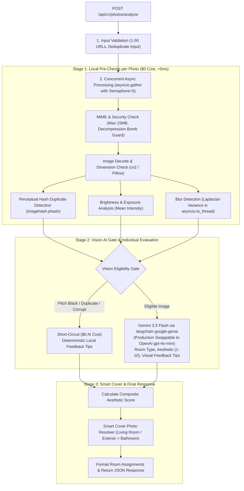

# Module 2 Architecture & Edge Case Plan: Photo Categorization & Quality Scoring

This document details the engineering specifications, algorithm thresholds, and edge-case handling for **Module 2: Photo Categorization & Quality Scoring** (`POST /api/v1/photos/analyze`).

---

## 1. System Pipeline Architecture



---

## 2. Centralized Constants & Thresholds (`app/core/constants.py`)

Per architectural decision, **all photo analysis thresholds and constants are centralized in `app/core/constants.py`** (as typed `Final` variables) rather than environment variables or isolated service files. This provides a single source of truth that can be imported cleanly across:
* **Services**: `app/services/photo_service.py` for algorithmic execution.
* **Models**: `app/models/photos.py` for payload validation bounds (e.g. `MAX_PHOTOS_PER_BATCH`).
* **Unit Tests**: `app/tests/test_photos.py` for testing threshold edge cases (e.g. variance `99.9` vs `100.1`).
* **CLI Scripts**: `app/scripts/compare_images.py` for local diagnostic calibration.

```python
# ==============================================================================
# PHOTO ANALYSIS & QUALITY CONSTANTS (app/core/constants.py)
# ==============================================================================
from typing import Final

BLUR_LAPLACIAN_THRESHOLD: Final[float] = 100.0       # < 100.0 is blurry; >= 100.0 is sharp
BRIGHTNESS_PITCH_BLACK: Final[float] = 15.0          # < 15.0 is pitch black (short-circuits LLM)
BRIGHTNESS_MIN: Final[float] = 35.0                  # < 35.0 is severely underexposed / dark
BRIGHTNESS_MAX: Final[float] = 220.0                 # > 220.0 is severely overexposed / blown out
DUPLICATE_HAMMING_THRESHOLD: Final[int] = 5          # Hamming distance <= 5 flags duplicate (short-circuits LLM)
MIN_IMAGE_DIMENSION: Final[int] = 400                # Min acceptable width & height in px
MAX_IMAGE_FILE_SIZE_BYTES: Final[int] = 10 * 1024 * 1024  # 10 MB stream limit
MAX_PHOTOS_PER_BATCH: Final[int] = 50                # Max photo URLs per analyze request
PHOTO_CONCURRENCY_LIMIT: Final[int] = 5              # Max parallel workers (asyncio.Semaphore)
PHOTO_DOWNLOAD_TIMEOUT_SECONDS: Final[float] = 8.0   # CDN download timeout
VISION_IMAGE_DETAIL: Final[str] = "low"              # 512x512 low-res tile (flat 85 tokens per image)

VALID_ROOM_TYPES: Final[tuple[str, ...]] = (
    "Living Room",
    "Bedroom",
    "Bathroom",
    "Kitchen",
    "Balcony/Patio",
    "Dining Room",
    "Exterior/Entrance",
    "Amenities/Pool",
    "Other",
)
```

In `app/services/photo_service.py`, constants are cleanly imported:
```python
from core.constants import (
    BLUR_LAPLACIAN_THRESHOLD,
    BRIGHTNESS_MIN,
    BRIGHTNESS_MAX,
    BRIGHTNESS_PITCH_BLACK,
    DUPLICATE_HAMMING_THRESHOLD,
    MIN_IMAGE_DIMENSION,
    MAX_IMAGE_FILE_SIZE_BYTES,
    PHOTO_CONCURRENCY_LIMIT,
    PHOTO_DOWNLOAD_TIMEOUT_SECONDS,
    VISION_IMAGE_DETAIL,
    VALID_ROOM_TYPES,
)
```

---

## 3. Core Algorithms & Evaluation Criteria

### 3.1 Blur Detection (Laplacian Variance)
* **Algorithm**: Compute the discrete Laplace operator on a grayscale representation of the image:
  $$\sigma^2 = \text{Var}(\nabla^2 I)$$
* **Authoritative Thresholds**:
  * $\sigma^2 < 100.0$: **Blurry** (`is_blurry = True`). Motion blur, out-of-focus lens, or heavy compression.
  * $\sigma^2 \ge 100.0$: **Sharp** (`is_blurry = False`).
* **Optimization**: Executed inside `asyncio.to_thread()` to prevent blocking FastAPI's ASGI event loop.

### 3.2 Brightness & Exposure Analysis
* **Algorithm**: Calculate the mean pixel intensity across the grayscale matrix $Y \in [0, 255]$:
  $$\mu = \frac{1}{N} \sum_{i,j} I(i, j)$$
* **Authoritative Thresholds**:
  * $\mu < 15.0$: **Pitch Black / Lens Cap On**. Immediately short-circuits LLM; lighting score `1/10`.
  * $15.0 \le \mu < 35.0$: **Severely Underexposed / Dark** (`flags.is_too_dark = True`).
  * $35.0 \le \mu \le 220.0$: **Optimal Lighting Window**.
  * $\mu > 220.0$: **Severely Overexposed / Blown Out** (`flags.is_overexposed = True`).

### 3.3 Duplicate Detection (Perceptual Hashing)
* **Algorithm**: Compute 64-bit DCT-based Perceptual Hash (`imagehash.phash`).
* **Comparison**: Calculate Hamming distance $D_H(\text{hash}_A, \text{hash}_B)$ for all pairs within the listing batch:
  * $D_H \le 5$: **Near-Duplicate / Duplicate**. The subsequent image is flagged:
    ```json
    {
      "is_duplicate": true,
      "duplicate_of": "https://storage.domain.com/original_photo.jpg"
    }
    ```
    Duplicates **skip the LLM call entirely**, saving AI costs.
  * $D_H > 5$: **Distinct Scene**.

### 3.4 Non-Property & Document Detection (Newspapers, Memes, Documents)
* **What it checks**: Evaluates whether the photo actually portrays a legitimate accommodation space or amenity vs. non-property media (e.g. newspapers, documents, screenshots of chats, memes, selfies, pets without property context).
* **Enforcement**:
  * If `is_relevant_property_photo == False`:
    * `room_type = "Other"`
    * `flags.is_non_property = True`
    * `flags.poor_quality = True`
    * `feedback_tips = ["Please upload genuine accommodation photos showing the property, rooms, or amenities."]`
    * **Permanently disqualified** from being chosen as the recommended cover photo.

---

## 4. Two-Tier Feedback Tips System (`feedback_tips`)

Hosts receive actionable tips for each individual photo. To maximize speed, save AI cost, and guarantee pinpoint precision, tips are generated through a two-tier mechanism:

### Tier 1: Local Pre-Check Tips ($0 AI Cost)
When a photo fails local pre-checks, it is **short-circuited** (never sent to OpenAI). Local deterministic rules generate immediate feedback tips:

| Local Check Failure | Condition | Generated Feedback Tip |
| :--- | :--- | :--- |
| **Duplicate Photo** | $D_H \le 5$ | `"Duplicate photo detected. Keep only your best angle."` |
| **Pitch Black / Dark** | $\mu < 35.0$ | `"Lighting is dim. Turn on room lights or photograph during daytime."` |
| **Overexposed** | $\mu > 220.0$ | `"Image is overexposed or washed out by harsh flash."` |
| **Blurry** | $\sigma^2 < 100.0$ | `"Image appears blurry or out of focus. Consider retaking with a steady camera."` |
| **Low Resolution** | Width or Height $< 400\text{px}$ | `"Image resolution is below 400x400. Upload higher resolution photos for crisp display."` |
| **Corrupt / Invalid** | Byte decode failure | `"Invalid or unreadable image file. Please re-upload in standard JPG or PNG format."` |

### Tier 2: Individual Vision AI Evaluation (Eligible Photos Only)
Photos that pass local pre-checks are evaluated **one photo at a time** in parallel (concurrency controlled via `asyncio.Semaphore(5)`). 

#### Active AI Provider (Demo / Preview Phase): Google Gemini 3.5 Flash
* **Model**: **`gemini-3.5-flash`** via **`langchain-google-genai`**.
* **Reasoning**: Gemini 1.5 and 2.5 baseline are discontinued for new projects on Google AI Studio. Gemini 3.5 Flash provides active free quotas (15 RPM, 1,500 RPD, 1M TPM) without requiring upfront credit card billing, enabling a complete working preview for client sign-off.
* **LangChain Integration**:
  ```python
  from langchain_google_genai import ChatGoogleGenerativeAI
  from langchain_core.output_parsers import JsonOutputParser

  llm = ChatGoogleGenerativeAI(
      model=settings.GEMINI_MODEL,  # "gemini-3.5-flash"
      google_api_key=settings.GOOGLE_API_KEY,
      temperature=0.2,
  )
  parser = JsonOutputParser(pydantic_object=PhotoAIAnalysis)
  vision_chain = llm | parser
  ```

#### Production Transition Guide (Switch to OpenAI)
When the client approves the preview and provides their paid OpenAI API key:
1. Set `OPENAI_API_KEY=sk-proj-...` in `app/.env`.
2. In `app/services/photo_service.py`, swap the LangChain client to `ChatOpenAI`:
   ```python
   from langchain_openai import ChatOpenAI

   vision_model = ChatOpenAI(
       model=settings.OPENAI_VISION_MODEL,  # "gpt-4o-mini"
       openai_api_key=settings.OPENAI_API_KEY,
       temperature=0.2,
   ).with_structured_output(PhotoAIAnalysis)
   ```
   *Because LangChain standardizes `.with_structured_output()`, both providers populate the exact same `PhotoAIAnalysis` Pydantic model with zero changes to downstream business logic.*

#### Why Photos are Evaluated Individually (Not All at Once)
1. **No Token or Context Limits**: Sending 20–50 photos in a single prompt risks context truncation, rate-limit spikes, and model confusion across images.
2. **Fault Isolation**: If one image URL is slow or fails, other photos finish instantly without blocking the batch.
3. **Pinpoint Precision**: The model evaluates the specific scene in isolation and produces targeted aesthetic tips:
   * `"Open window blinds to capture natural daylight."`
   * `"Declutter kitchen counter before taking photo."`
   * `"Straighten horizontal camera angle."`
   * `"Smooth out bed linens and arrange pillows neatly."`
4. **Clean Merge**: If a photo is slightly blurry locally ($\sigma^2 < 100$) but still eligible for room categorization, local tips and Vision tips are cleanly merged into `feedback_tips`. If the photo is already excellent, `feedback_tips: []`.

---

## 5. Smart Cover Photo Selection Hierarchy

The marketplace cover image is an AI recommendation and is **not mandatory** (returns `None` / `null` if no uploaded photo qualifies):
1. **Rule 1 (Strict Exclusion)**: Never select photos flagged as `is_blurry = True`, `is_duplicate = True`, `is_non_property = True`, `poor_quality = True`, or `room_type in ("Bathroom", "Other", None)`.
2. **Rule 2 (Anti-Bathroom Rule)**: Bathrooms are strictly excluded from being cover images (guests dislike seeing a bathroom/toilet as the primary search result thumbnail).
3. **Rule 3 (Room Priority Hierarchy)**:
   * **Tier 1 (Preferred)**: `Living Room` or `Exterior/Entrance` with $\text{overall\_aesthetic} \ge 7.0$.
   * **Tier 2 (Secondary)**: `Bedroom`, `Balcony/Patio`, or `Amenities/Pool` with high aesthetic score ($\ge 7.0$).
   * **Tier 3 (Tertiary)**: Any qualified, non-bathroom, non-blurry, good-quality property space with the highest composite score.
   * **No Forced Fallback**: If no photo in the batch satisfies quality gates, `recommended_cover_photo` returns `null` and `is_recommended_cover: false` for all photos.

---

## 6. Comprehensive Edge Cases & Mitigations

| Category | Edge Case Scenario | Impact if Unhandled | Built-in Defense & Mitigation |
| :--- | :--- | :--- | :--- |
| **Input Validation** | Empty photo list (`"photos": []`) | Zero-division / index crash | Pydantic validation: `Field(..., min_length=1, max_length=50)`. Returns `422`. |
| **Input Validation** | Duplicate URLs in input (`["url1", "url1"]`) | Redundant network downloads & duplicate AI calls | Deduplicate input list upfront preserving order: `list(dict.fromkeys(req.photos))`. |
| **Security / DoS** | Decompression Bomb (e.g. 50,000 x 50,000 px) | Server Out-of-Memory (OOM) | Enforce `Image.MAX_IMAGE_PIXELS = 50_000_000` and stream download limit $\le 15\text{MB}$. |
| **Security / DoS** | Non-image payload (e.g. PDF/HTML renamed to `.jpg`) | Corrupt byte decode errors | Inspect magic bytes and MIME header. Mark photo as `is_non_property=True, scores=None, room_type=None, poor_quality=True`. |
| **Network Resilience** | Photo CDN 404, 500, or connection timeout | Stalled request | `httpx.AsyncClient` with `timeout=8.0`, SSL fallback, and per-photo isolated `try/except`. Returns `scores=None, room_type=None, poor_quality=True`. |
| **Local Check** | Pitch-black image (lens cap on / pitch black) | Laplacian variance is `0.0`, skews AI | Mean brightness check ($\mu < 15.0$) flags image as pitch-black, setting `scores=None, room_type=None, poor_quality=True` and skipping Vision API ($0 AI Cost). |
| **Local Check** | Tiny icons / thumbnails (e.g. 64x64 px) | Looks blurry on high-DPI displays | Dimensions check: `width < 400` or `height < 400` flags `poor_quality=True`. |
| **Local Check** | Extreme aspect ratios (< 0.4 or > 2.5) | Awkward panoramic or ribbon display | Generates host feedback tip recommending standard landscape (4:3 or 16:9). |
| **Concurrency** | Batch of 30 high-res images processed simultaneously | Memory spikes & provider rate limits | Controlled worker pool using `asyncio.Semaphore(5)` for downloads and analysis. |
| **AI Cost Control** | Sending confirmed duplicates to AI Vision | Wastes unnecessary AI calls per redundant photo | Skip Vision call for images already confirmed as duplicates by `phash` ($\le 5$). Sets `scores=None, room_type=None`. |
| **Vision Schema** | LLM outputs non-standard category (e.g. `"Gym"`) | Breaks client UI tabs | Strict mapping into `VALID_ROOM_TYPES` (`Living Room`, `Bedroom`, `Bathroom`, `Kitchen`, `Balcony/Patio`, `Dining Room`, `Exterior/Entrance`, `Amenities/Pool`, `Other`). |
| **Non-Property Media** | Memes, receipts, documents, selfies, teddy bears | Meaningless aesthetic ratings & polluted room catalog | Flagged with `is_non_property=True`, `scores=None`, `room_type=None`, and excluded from `room_assignments`. |
| **Smart Cover** | All photos in listing are blurry, poor quality, or bathroom | Bad or inappropriate thumbnail shown to guests | Cover photo is optional; returns `recommended_cover_photo: null` when no photo qualifies. |
