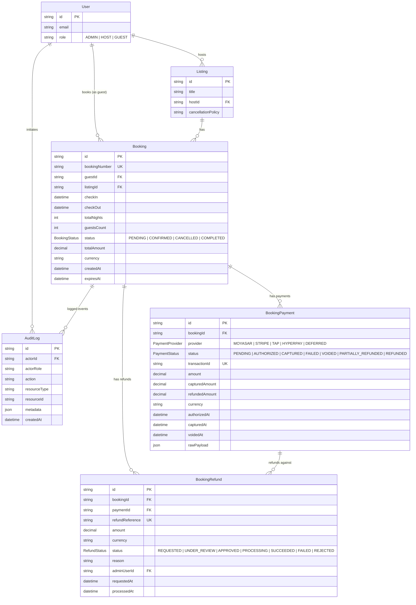
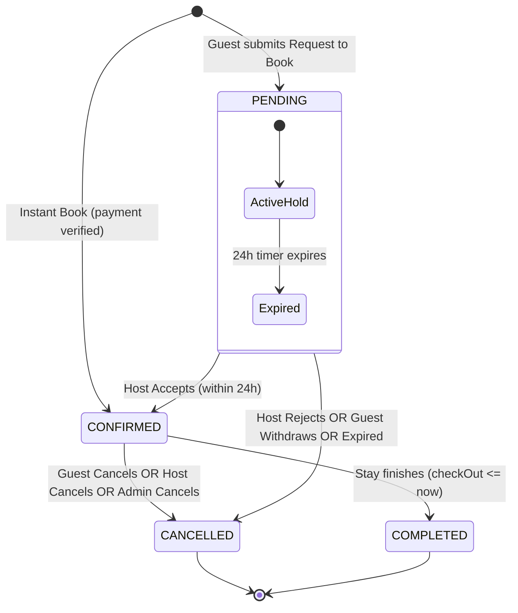
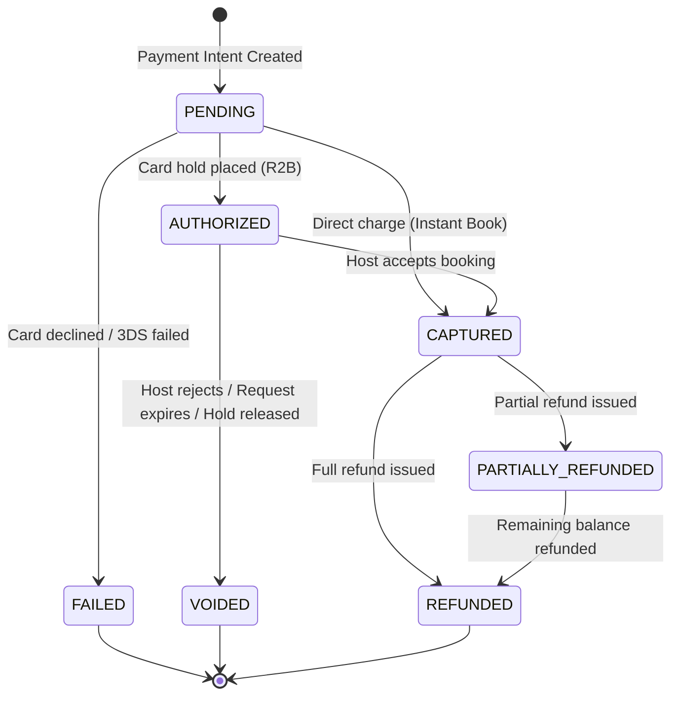
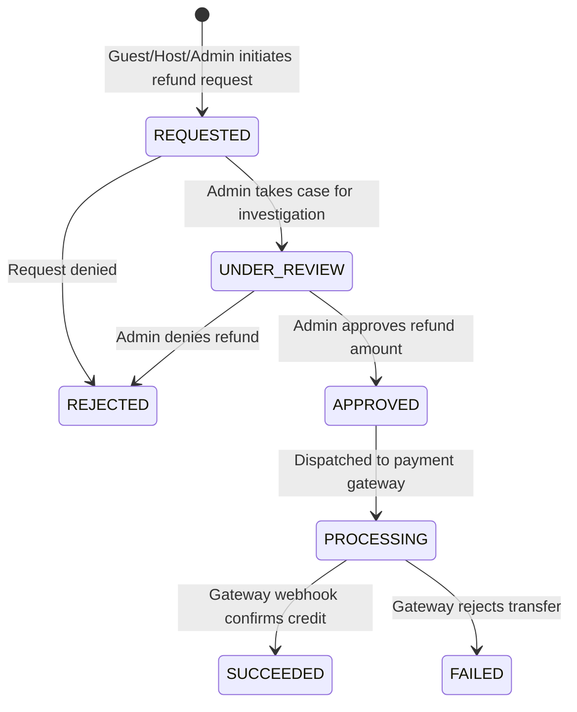

# HOMYZ — ADMIN BOOKING & REFUND MANAGEMENT
## PHASE 2 ARCHITECTURE: FOUNDATION SPECIFICATION & SYSTEM DESIGN

**Platform:** Homyz Travel & Hospitality Platform  
**Target Module:** Admin Booking & Refund Management (Technical Foundation)  
**Status:** Approved & Implemented  
**Date:** October 2026  
**Architect:** Senior Next.js Architect, Backend Engineer, Database Architect & Security Auditor  

---

## 1. EXECUTIVE SUMMARY & FOUNDATION OBJECTIVES

Phase 2 establishes the secure, high-performance, and verifiable technical foundation for **Admin Booking & Refund Management** within Homyz. It bridges the gap between existing Guest/Host transaction flows and centralized back-office administration without disrupting existing features or altering production data.

### Key Architectural Deliverables Established in Phase 2:
1. **Centralized Booking & Financial Lifecycle State Machine** (`lib/booking/booking-lifecycle.ts`): Enforces strict, server-side transition matrices, preventing invalid status transitions, duplicate captures, unauthorized releases, and invalid refunds.
2. **Explicit Database Financial Models & Enums** (`prisma/schema.prisma`): Introduced `BookingPayment`, `BookingRefund`, `PaymentStatus`, `PaymentProvider`, and `RefundStatus` with non-destructive, additive migrations and `ON DELETE RESTRICT` foreign key protections to preserve audit trails.
3. **Optimized Administrative Read APIs** (`app/api/v1/admin/bookings/`): Server-side paginated, bounded (`take <= 100`), filterable, indexed endpoints providing booking summaries, granular details, and timeline activity logs without exposing private arrival guide secrets.
4. **Complete Audit Traceability** (`services/booking.service.ts` & `services/audit.service.ts`): Connected guest cancellations, host cancellations, and administrative status mutations directly to immutable `AuditLog` records.
5. **Role-Based Access Control & Secret Sanitization**: Server-side RBAC guards protecting admin endpoints, enforcing least privilege, and stripping sensitive host arrival secrets (`wifiPassword`, `doorCode`, `lockboxCode`) from administrative views.
6. **Concurrency & Double-Booking Protection**: Formalized PostgreSQL transactional advisory locking (`pg_advisory_xact_lock`) with active hold resolution and automated 24-hour request expiry cleanup.

---

## 2. DATABASE ARCHITECTURE & RELATIONSHIPS

### 2.1 Entity Relationship Diagram



### 2.2 Data Integrity & Foreign Key Policies
- **No Cascade Deletes on Financial Entities**: `BookingPayment` and `BookingRefund` use `onDelete: Restrict` on `bookingId` and `paymentId`. A listing or user deletion cannot cascade to destroy financial transaction records or ledger history.
- **Unique Constraints**:
  - `BookingPayment.transactionId` (`@unique`): Prevents duplicate transaction recordings for the same payment gateway reference.
  - `BookingRefund.refundReference` (`@unique`): Prevents replay attacks or double-crediting of refunds.
- **Precise Financial Representation**: All monetary fields (`amount`, `capturedAmount`, `refundedAmount`) use `Decimal(12, 2)` or integer cents in service calculations, completely eliminating floating-point rounding errors.

### 2.3 Indexing Strategy for Fast Admin Queries
To support high-throughput admin queries without table scans:
1. `Booking`:
   - `@@index([status])`: Fast status facet filtering (`PENDING`, `CONFIRMED`, `CANCELLED`).
   - `@@index([status, createdAt])`: Composite index for sorted status-filtered dashboards.
   - `@@index([createdAt])`: Date-range queries and descending default order.
   - Existing indexes retained: `[guestId]`, `[listingId]`, `[checkIn, checkOut]`.
2. `BookingPayment`:
   - `@@index([bookingId])`: O(1) lookup of payment transactions for a given booking.
   - `@@index([status])`: Filtering payments needing reconciliation.
   - `@@index([transactionId])`: Webhook lookup by provider ID.
3. `BookingRefund`:
   - `@@index([bookingId])`: O(1) lookup of refunds for a booking.
   - `@@index([paymentId])`: Quick balance derivation of refunded amounts against a specific payment.
   - `@@index([status])`: Admin refund approval queue filtering (`REQUESTED`, `UNDER_REVIEW`).
4. `AuditLog`:
   - `@@index([resourceType, resourceId])`: Enables sub-millisecond timeline queries (`resourceType = 'BOOKING'`, `resourceId = booking.id`).

---

## 3. LIFECYCLE STATE MACHINES & BUSINESS LOGIC

### 3.1 Booking Status Lifecycle

The system separates conceptual workflow states while maintaining backward compatibility with the database enum `BookingStatus` (`PENDING`, `CONFIRMED`, `CANCELLED`, `COMPLETED`):



#### Status Transition Matrix (`VALID_BOOKING_TRANSITIONS`):
| Current Status | Permitted Next Statuses | Actor Authorization |
|---|---|---|
| `DRAFT` | `PENDING_HOST_CONFIRMATION`, `CONFIRMED` | Guest |
| `PENDING` / `PENDING_HOST_CONFIRMATION` | `CONFIRMED`, `REJECTED`, `EXPIRED`, `CANCELLED` | Host (Accept/Reject), System (Expiry), Guest (Withdraw) |
| `CONFIRMED` | `COMPLETED`, `CANCELLED` | System (Checkout date), Guest (Cancel), Host (Cancel), Admin |
| `REJECTED` | *(Terminal)* None | - |
| `EXPIRED` | *(Terminal)* None | - |
| `CANCELLED` | *(Terminal)* None | - |
| `COMPLETED` | *(Terminal)* None | - |

Any transition outside this matrix is rejected server-side with `INVALID_BOOKING_TRANSITION`.

### 3.2 Payment Status Lifecycle

Payment states are tracked independently from booking states:



#### Invariant Guards:
1. **Capture Guard (`validatePaymentCapture`)**: Payment capture is ONLY valid if the booking is `CONFIRMED` or `PENDING` being transitioned to `CONFIRMED`, and current payment status is `AUTHORIZED`. Double capture is strictly prohibited.
2. **Release/Void Guard (`validatePaymentRelease`)**: Authorization can only be released/voided if the booking is in a terminal state (`REJECTED`, `EXPIRED`, `CANCELLED`).
3. **No Unpaid Confirmations**: Instant Bookings cannot reach `CONFIRMED` status without payment verification reaching `CAPTURED` (or `DEFERRED` during mock mode).

### 3.3 Refund Status Lifecycle & Financial Caps

Refund tracking accommodates approval workflows prior to gateway transmission:



#### Financial Bounds & Zero Floating-Point Arithmetic:
- Every refund calculation enforces:
  $$\text{Total Refunded So Far} + \text{New Refund Request} \le \text{Captured Payment Amount}$$
- Enforced via integer minor units (`Math.round(amount * 100)`) in `validateRefundEligibility` (`lib/booking/booking-lifecycle.ts`).
- Floating-point discrepancies such as `0.1 + 0.2 = 0.30000000000000004` are strictly prevented.

---

## 4. SERVICE RESPONSIBILITIES & MODULAR ARCHITECTURE

To eliminate code duplication across web routes, server actions, and cron jobs, the foundational responsibilities are assigned to distinct, decoupled services:

```
┌────────────────────────────────────────────────────────────────────────┐
│                        API Routes & Controllers                        │
│  /api/v1/admin/bookings  │  /api/v1/host/bookings  │  /api/v1/checkout │
└───────────────────────────────────┬────────────────────────────────────┘
                                    │
                                    ▼
┌────────────────────────────────────────────────────────────────────────┐
│                        Shared Service Layer                            │
│  ┌───────────────────────────────┐  ┌────────────────────────────────┐  │
│  │     booking.service.ts        │  │     booking-lifecycle.ts       │  │
│  │ - listForAdmin (paginated)    │  │ - State machine transitions    │  │
│  │ - getAdminBookingDetails      │  │ - Capture/release invariants   │  │
│  │ - getAdminBookingSummary      │  │ - Refund eligibility math      │  │
│  │ - getAdminBookingActivity     │  │ - Arrival secret sanitization  │  │
│  │ - cancellation & confirmation │  │ - Lifecycle status mapping     │  │
│  └───────────────┬───────────────┘  └────────────────┬───────────────┘  │
│                  │                                   │                  │
│  ┌───────────────▼───────────────┐  ┌────────────────▼───────────────┐  │
│  │       audit.service.ts        │  │      availability.service.ts   │  │
│  │ - record (immutable audit)   │  │ - checkAvailability           │  │
│  │ - listForResource             │  │ - Active holds & 24h expiry    │  │
│  └───────────────────────────────┘  └────────────────────────────────┘  │
└───────────────────────────────────┬────────────────────────────────────┘
                                    │
                                    ▼
┌────────────────────────────────────────────────────────────────────────┐
│                    Prisma ORM & PostgreSQL Database                    │
│   Booking | BookingPayment | BookingRefund | Listing | User | AuditLog │
└────────────────────────────────────────────────────────────────────────┘
```

### Responsibility Boundaries:
1. `bookingService` (`services/booking.service.ts`):
   - Admin listing, search, pagination, and multi-faceted filtering.
   - Metrics aggregation via SQL `groupBy` and count queries.
   - Core booking actions (accept, reject, cancel by guest, cancel by host).
   - Sanitization of sensitive listing data prior to admin serialization.
2. `bookingLifecycle` (`lib/booking/booking-lifecycle.ts`):
   - Pure, deterministic state machine transition rules.
   - Financial invariants and validation logic.
   - Secret stripping utilities (`sanitizeListingSecrets`).
3. `auditService` (`services/audit.service.ts`):
   - Structured audit logging for compliance, tracking actor ID, role, action, target resource, and change metadata.
4. `availabilityService` (`services/availability.service.ts`):
   - Calendar range availability checks, considering confirmed reservations and active (non-expired) pending holds.
5. `paymentPolicy` (`lib/booking/payment-policy.ts`):
   - Gateway operational mode detection (`DEFERRED`, `MOCK`, `LIVE_MOYASAR`).

---

## 5. CONCURRENCY CONTROL & DOUBLE-BOOKING PROTECTION

### 5.1 Concurrency Architecture
The system prevents double bookings and concurrent race conditions through a 3-layer defense mechanism:

1. **Transactional Advisory Lock**:
   ```sql
   SELECT pg_advisory_xact_lock(hashtext('booking:listing:' || listingId));
   ```
   - Automatically serialized at the PostgreSQL transaction level for checkout creations and host acceptances.
   - The lock is strictly scoped to the active database transaction and auto-released on commit or rollback.
2. **Deterministic Overlap Query**:
   Within the serialized transaction, checks for any existing booking where:
   ```sql
   status IN ('CONFIRMED', 'PENDING')
   AND (status != 'PENDING' OR expiresAt > NOW())
   AND checkIn < newCheckOut
   AND checkOut > newCheckIn
   ```
3. **Automated Expiry Sweeper (`POST /api/v1/bookings/expire-stale`)**:
   - Sweeps requests exceeding the 24-hour host response window (`expiresAt < NOW()`).
   - Automatically transitions status from `PENDING` to `CANCELLED` with metadata `cancellationReason = 'EXPIRED_HOST_TIMEOUT'`.
   - Frees calendar inventory instantly.
   - Protected by `requireApiAuth` to prevent unauthorized invocation.

---

## 6. ROLE-BASED ACCESS CONTROL (RBAC) & SENSITIVE DATA PROTECTION

### 6.1 Role Permission Matrix
| Capability | ADMIN | HOST | GUEST | Unauthenticated |
|---|:---:|:---:|:---:|:---:|
| `VIEW_ANY_BOOKINGS` | ✅ | ❌ | ❌ | ❌ |
| `VIEW_OWN_BOOKINGS` | ✅ | ✅ (as host) | ✅ (as guest) | ❌ |
| `VIEW_FINANCIAL_BREAKDOWN` | ✅ | ✅ (host payout) | ✅ (guest total) | ❌ |
| `VIEW_ADMIN_METRICS` | ✅ | ❌ | ❌ | ❌ |
| `VIEW_BOOKING_AUDIT_LOGS` | ✅ | ❌ | ❌ | ❌ |
| `APPROVE_REFUND` (Phase 3+) | ✅ | ❌ | ❌ | ❌ |
| `TRIGGER_PAYMENT_CAPTURE` | ✅ (System/Admin) | ✅ (via Accept) | ❌ | ❌ |
| `VIEW_ARRIVAL_SECRETS` | ❌ (Redacted) | ✅ (Owner) | ✅ (Confirmed only) | ❌ |

### 6.2 Sensitive Data Redaction Policy
Arrival secrets stored in `Listing` (e.g. `wifiPassword`, `doorCode`, `lockboxCode`) are strictly confidential:
- Guests may only see them after a reservation is **CONFIRMED** and check-in window opens.
- Administrative listing and booking views (`getAdminBookingDetails`, `listForAdmin`) pass listing payloads through `sanitizeListingSecrets`:
  ```typescript
  export function sanitizeListingSecrets<T extends Record<string, any>>(listing: T): T {
    const sanitized = { ...listing };
    delete sanitized.wifiPassword;
    delete sanitized.doorCode;
    delete sanitized.lockboxCode;
    return sanitized;
  }
  ```
- This prevents accidental credential exfiltration via administrative dashboard screens or support console inspection.

---

## 7. REUSABLE ADMIN READ APIS

All admin booking APIs follow consistent RESTful conventions under `/api/v1/admin/bookings`:

### 7.1 Endpoints Specification

#### `GET /api/v1/admin/bookings`
- **Purpose**: Paginated, filterable, and searchable booking registry.
- **Security**: Requires authenticated user with `role === 'ADMIN'`.
- **Query Parameters**:
  - `page` (default: `1`): Current page number.
  - `limit` (default: `20`, maximum: `100`): Bounded page size to prevent memory exhaustion.
  - `status`: Optional filter (`PENDING`, `CONFIRMED`, `CANCELLED`, `COMPLETED`).
  - `paymentStatus`: Optional filter (`PENDING`, `AUTHORIZED`, `CAPTURED`, `REFUNDED`, etc.).
  - `propertyId`: Optional listing ID filter.
  - `hostId`: Optional host user ID filter.
  - `guestId`: Optional guest user ID filter.
  - `search`: Case-insensitive search matching booking number, listing title, guest name, or guest email.
  - `startDate` / `endDate`: ISO 8601 creation date range filters.
  - `sortBy` / `sortOrder`: Sorting by `createdAt`, `checkIn`, `checkOut`, or `totalAmount` (`asc` / `desc`).
- **Response Format**:
  ```json
  {
    "success": true,
    "data": [
      {
        "id": "cm...1",
        "bookingNumber": "BK-1001",
        "status": "CONFIRMED",
        "checkIn": "2026-11-01T00:00:00.000Z",
        "checkOut": "2026-11-05T00:00:00.000Z",
        "totalAmount": 1250.00,
        "currency": "SAR",
        "guest": { "id": "u1", "name": "Sarah G.", "email": "sarah@example.com" },
        "listing": { "id": "l1", "title": "Sea View Villa", "city": "Jeddah", "host": { ... } }
      }
    ],
    "pagination": {
      "page": 1,
      "limit": 20,
      "total": 142,
      "totalPages": 8,
      "hasNextPage": true,
      "hasPrevPage": false
    }
  }
  ```

#### `GET /api/v1/admin/bookings/summary`
- **Purpose**: High-level aggregated business KPIs for the admin dashboard header.
- **Security**: Requires authenticated user with `role === 'ADMIN'`.
- **Response Format**:
  ```json
  {
    "success": true,
    "data": {
      "total": 142,
      "pending": 8,
      "confirmed": 94,
      "completed": 32,
      "cancelled": 8,
      "totalGrossVolume": 384500.00,
      "currency": "SAR"
    }
  }
  ```

#### `GET /api/v1/admin/bookings/:id`
- **Purpose**: Comprehensive booking detail record with sanitized listing metadata and payment/refund histories.
- **Security**: Requires authenticated user with `role === 'ADMIN'`.
- **Response Format**: Returns full booking object, sanitized listing, guest profile, pricing breakdown, associated `BookingPayment` records, and `BookingRefund` records.

#### `GET /api/v1/admin/bookings/:id/activity`
- **Purpose**: Chronological timeline audit log of all events for the target booking.
- **Security**: Requires authenticated user with `role === 'ADMIN'`.
- **Response Format**:
  ```json
  {
    "success": true,
    "data": [
      {
        "id": "aud_1",
        "actorId": "u_host",
        "actorRole": "HOST",
        "action": "BOOKING_ACCEPTED",
        "createdAt": "2026-10-10T12:00:00.000Z",
        "metadata": { "bookingNumber": "BK-1001", "previousStatus": "PENDING" }
      }
    ]
  }
  ```

---

## 8. MIGRATION & DATABASE SAFETY

### 8.1 Migration File: `20261010140000_admin_booking_foundation`
- **Type**: 100% Additive DDL.
- **Safety Guarantees**:
  - No existing tables dropped, altered destructively, or truncated.
  - Zero downtime: Existing columns in `Booking`, `Listing`, and `User` remain unaltered.
  - Backward compatibility: Existing code inserting into `Booking` continues to operate unimpeded.
- **DDL Execution**:
  ```sql
  -- 1. Create Enums if not exist
  CREATE TYPE "PaymentStatus" AS ENUM ('PENDING', 'AUTHORIZED', 'CAPTURED', 'FAILED', 'VOIDED', 'PARTIALLY_REFUNDED', 'REFUNDED');
  CREATE TYPE "PaymentProvider" AS ENUM ('MOYASAR', 'STRIPE', 'TAP', 'HYPERPAY', 'DEFERRED');
  CREATE TYPE "RefundStatus" AS ENUM ('REQUESTED', 'UNDER_REVIEW', 'APPROVED', 'PROCESSING', 'SUCCEEDED', 'FAILED', 'REJECTED');

  -- 2. Create BookingPayment table
  CREATE TABLE IF NOT EXISTS "BookingPayment" (
      "id" TEXT NOT NULL PRIMARY KEY,
      "bookingId" TEXT NOT NULL,
      "provider" "PaymentProvider" NOT NULL DEFAULT 'DEFERRED',
      "status" "PaymentStatus" NOT NULL DEFAULT 'PENDING',
      ...
      CONSTRAINT "BookingPayment_bookingId_fkey" FOREIGN KEY ("bookingId") REFERENCES "Booking"("id") ON DELETE RESTRICT ON UPDATE CASCADE
  );

  -- 3. Create BookingRefund table
  CREATE TABLE IF NOT EXISTS "BookingRefund" (
      "id" TEXT NOT NULL PRIMARY KEY,
      "bookingId" TEXT NOT NULL,
      "paymentId" TEXT,
      ...
      CONSTRAINT "BookingRefund_bookingId_fkey" FOREIGN KEY ("bookingId") REFERENCES "Booking"("id") ON DELETE RESTRICT ON UPDATE CASCADE
  );

  -- 4. Add Performance Indexes
  CREATE INDEX IF NOT EXISTS "Booking_status_idx" ON "Booking"("status");
  CREATE INDEX IF NOT EXISTS "Booking_status_createdAt_idx" ON "Booking"("status", "createdAt");
  CREATE INDEX IF NOT EXISTS "Booking_createdAt_idx" ON "Booking"("createdAt");
  CREATE INDEX IF NOT EXISTS "AuditLog_resourceType_resourceId_idx" ON "AuditLog"("resourceType", "resourceId");
  ```

---

## 9. TRANSITION TO PHASE 3 (ADMIN BOOKING DASHBOARD & REFUND UI)

With Phase 1 (Audit) and Phase 2 (Foundation Architecture & APIs) verified and stable, the system provides:
1. Standardized REST endpoints ready for React Query / SWR / Server Component consumption in Phase 3.
2. Verified server-side pagination to power the Admin Booking Table without browser memory constraints.
3. Pre-configured `BookingRefund` and `BookingPayment` models and mathematical validations ready for the upcoming refund approval modals and dispute management interfaces.
4. Complete audit trace logging guaranteeing that any administrative refund or override taken in Phase 3 will be permanently recorded with actor correlation.

