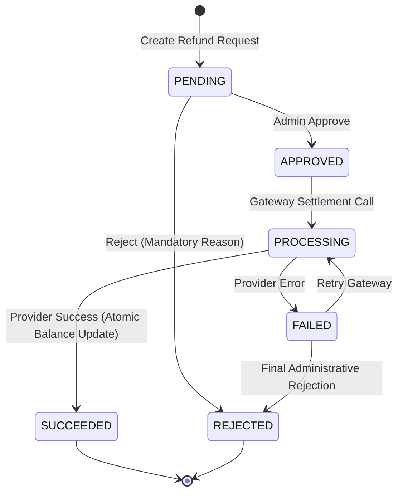

# Phase 10: Refund Requests, Approval & Processing Management

## 1. Executive Overview

Phase 10 implements the complete administrative operational workflow for **Refund Management** in the Homyz property booking platform (`services/refund.service.ts` and `/admin/bookings/refunds`). It connects the deterministic Phase 9 Policy Engine with actual database records, administrative review queues, financial approvals, gateway settlement execution, and guest notifications.

---

## 2. Architecture & Data Model

The refund lifecycle is backed by Prisma models in `prisma/schema.prisma`:
- `BookingRefund`: Stores individual refund requests, references, amounts (minor units), statuses, approving admin, failure reasons, and calculation snapshots.
- `BookingPayment`: Tracks captured amounts and cumulative refunded amounts, updated atomically during gateway execution.
- `AuditLog`: Records immutable audit events (`"REFUND_REQUESTED"`, `"REFUND_APPROVED"`, `"REFUND_REJECTED"`, `"REFUND_PROCESSED"`).
- `Notification`: Automatically notifies guests upon refund settlement.

### Lifecycle State Machine

---

## 3. Financial Invariants & Segregation of Duties

1. **Balance Safeguard**:
   Every refund creation and processing operation checks captured funds:
   $$\text{Available Balance} = \text{Captured Amount} - (\text{Already Refunded} + \text{Pending Reserved})$$
   If the requested refund exceeds the available balance, the request is rejected with `AppError.badRequest`.
2. **Segregation of Duties**:
   - Creating a refund request can be performed by authorized administrators.
   - Approval requires a distinct step (`POST /api/v1/admin/bookings/refunds/[id]/approve`).
   - If `ENFORCE_STRICT_DUAL_APPROVAL=true`, the approving admin cannot be the same administrator who initiated the request.
3. **Mandatory Rejection Rationale**:
   Rejections cannot be submitted without a non-empty explanation (`reason`). The reason is permanently recorded on the refund record and audit log.
4. **Idempotency Protection**:
   Processing requests require or generate an `idempotencyKey`. If a processed refund request is resubmitted with the same idempotency key, it safely returns the existing succeeded record without double-charging or duplicate refunds.

---

## 4. Payment Gateway Integration Safeguard

Per platform safety policies and development constraints:
- **Capability Verification**: Inspects `getPaymentPolicy()` from `lib/booking/payment-policy.ts`.
- **Live Gateway Safeguard**: If configured for `ONLINE_AUTHORIZATION` but live provider credentials are missing, execution is strictly blocked with an explanatory error, preventing accidental simulation of live money movement.
- **Sandbox / Development Mode**: In `DEFERRED` / `MOCK` mode, the service safely simulates provider settlement acknowledgment (`rfnd_sim_...`), updates payment records atomically in a `$transaction`, logs the audit event, and delivers guest notifications.

---

## 5. Admin Interface Implementation

### 5.1 Refunds Overview Queue (`/admin/bookings/refunds`)
- **8 KPI Summary Cards**:
  1. Total Refund Requests
  2. Pending Review
  3. Approved (Ready to Process)
  4. Processing in Gateway
  5. Succeeded
  6. Failed
  7. Rejected
  8. Total Refunded Volume (SAR)
- **7 Status Tabs**: All, Pending Review, Approved, Processing, Succeeded, Failed, Rejected.
- **Debounced Search**: Searches across refund reference, booking ID, guest name/email, property title, and host name.
- **Advanced Filter Drawer**: Modal drawer supporting policy, refund type (`FULL` / `PARTIAL`), and date range filtering.
- **"Create Refund Request" Modal**:
  - Live Quote Preview button evaluating policy engine in real-time.
  - Displays policy breakdown, check-in window status, and allowable amounts.
  - Optional Administrative Discretionary Override toggle with mandatory reason.
  - Locked scrolling using `ModalOverlay` from `@/components/ui/modal-overlay`.

### 5.2 Refund Request Detail & Action Center (`/admin/bookings/refunds/[id]`)
- **2-Column Responsive Layout**:
  - **Left Column**: Policy Calculation Breakdown Snapshot, Booking Information, Original Captured Payment Record, Activity & Financial Audit Trail.
  - **Right Column**: Financial Summary (large amount display, type badge, captured vs remaining balance), Workflow Status, and Action Controls.
- **Action Controls & Confirmation Modals**:
  - **Approve Refund**: Displays approval modal with optional internal notes.
  - **Reject Refund**: Displays rejection modal requiring mandatory reason.
  - **Process Refund via Gateway**: Displays execution modal with gateway settlement warning and authorization confirmation checkbox.
  - All modals use `ModalOverlay` with scroll locks.

---

## 6. API Route Catalog

| Endpoint | Method | RBAC Permission | Purpose |
| :--- | :--- | :--- | :--- |
| `/api/v1/admin/bookings/refunds` | `GET` | `BOOKINGS_VIEW` | Paginated refund requests list with multi-facet filters. |
| `/api/v1/admin/bookings/refunds` | `POST` | `PAYMENTS_REFUND` | Creates a new refund request with validation against captured balance. |
| `/api/v1/admin/bookings/refunds/summary` | `GET` | `BOOKINGS_VIEW` | Returns aggregate counts for all 8 KPI metrics. |
| `/api/v1/admin/bookings/refunds/[id]` | `GET` | `BOOKINGS_VIEW` | Returns single refund request with booking, payment, and audit history. |
| `/api/v1/admin/bookings/refunds/[id]/approve` | `POST` | `PAYMENTS_REFUND` | Approves a pending refund request. |
| `/api/v1/admin/bookings/refunds/[id]/reject` | `POST` | `PAYMENTS_REFUND` | Rejects a refund request with a mandatory reason. |
| `/api/v1/admin/bookings/refunds/[id]/process` | `POST` | `PAYMENTS_REFUND` | Executes refund settlement with payment provider atomically. |
| `/api/v1/admin/bookings/[id]/refund-quote` | `POST` | `BOOKINGS_VIEW` | Read-only calculation quote preview for a reservation. |
