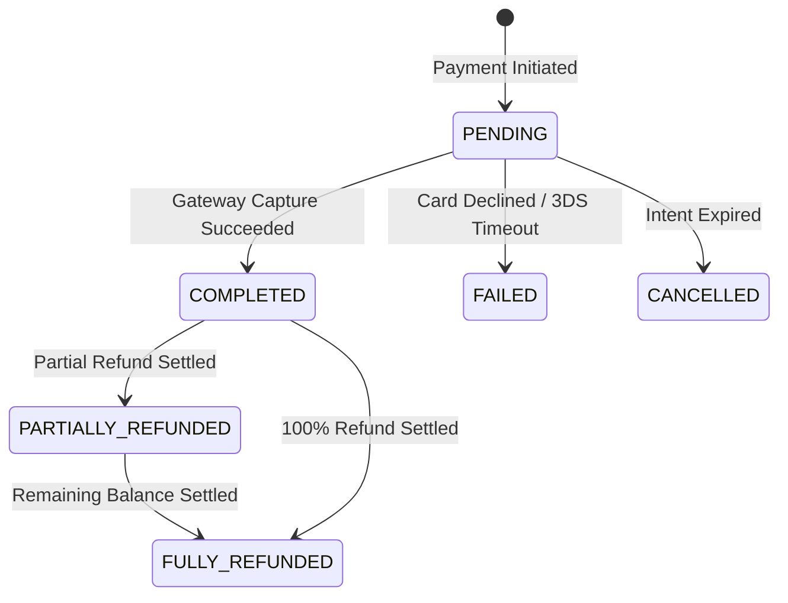
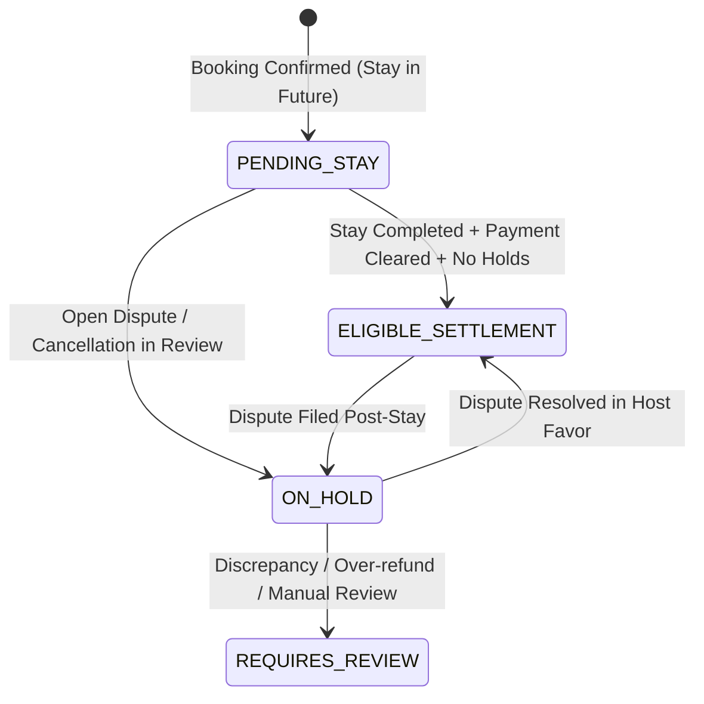

# Phase 11: Payment Status, Transactions & Host Payout Tracking

## 1. Executive Overview

Phase 11 establishes a centralized, auditable financial monitoring system for **Payment Status, Transactions, and Host Payout Tracking** in the Homyz Admin Booking & Refund Management suite.

It provides administrators with full real-time visibility into guest payment lifecycles, gateway transaction references, reconciliation balance verification, and host earnings readiness—without fabricating unverified disbursements or modifying raw financial records on the client side.

---

## 2. Architecture & Authoritative Data Sourcing

Phase 11 builds directly on the project's immutable booking financial architecture:

1. **Payment Model (`BookingPayment`)**:
   - Persists guest transaction attempts, provider charge references (`providerPaymentId`), captured amounts (`amount`), payment gateway (`provider`: Moyasar / Stripe), statuses (`COMPLETED`, `FAILED`, `PENDING`), and cumulative refunded sums.
   - Tied directly to `Booking` and `BookingRefund` relations in `prisma/schema.prisma`.
2. **Host Earnings & Settlement Source (`lib/booking/booking-financials.ts`)**:
   - Host payouts are never dynamically estimated or guessed from guest totals; they are authoritatively extracted from the immutable `booking.priceBreakdown.payoutBreakdown` snapshot via `extractStoredHostPayout()`.
   - Host earnings breakdown includes:
     - Accommodation Subtotal
     - Cleaning Fee (pass-through)
     - Pet Fee / Extra Guest Fees
     - Host Service Fee (deducted platform fee, typically 3%)
     - VAT on Host Fee (15% Saudi VAT)
     - Net Host Payout (`netHostPayout`)
3. **No Fabricated Disbursements**:
   - Automated direct bank payout disbursements are currently unconfigured on the platform. The system operates as an authoritative **read-only Settlement Readiness & Earnings Tracker**, correctly categorizing balances into `PENDING_STAY`, `ELIGIBLE_SETTLEMENT`, `ON_HOLD`, or `REQUIRES_REVIEW` rather than generating artificial bank transfers.

---

## 3. Financial Invariants & State Machines

### 3.1 Payment Lifecycle & Status Aggregates

### 3.2 Host Payout Readiness States

### 3.3 Core Financial Rules

1. **Balance Equation**:
   $$\text{Net Captured} = \text{Gross Captured} - \sum \text{Refunds Processed}$$
   $$\text{Remaining Refundable Balance} = \text{Gross Captured} - (\sum \text{Refunds Processed} + \sum \text{Pending Refunds})$$
2. **Settlement Timing**:
   Host funds remain in `PENDING_STAY` until the reservation's `endDate` has passed. Under standard Airbnb-style platform rules, payout readiness unlocks only once the guest has completed check-in and checkout without unresolved quality or damage claims.
3. **Dispute & Refund Holds**:
   If an open refund request or quality incident is linked to the booking, the host payout status is automatically flagged as `ON_HOLD`, preventing premature manual payout processing.

---

## 4. Payment Gateway Reconciliation Engine

Implemented in `services/payment-admin.service.ts` via `reconcilePaymentForAdmin(actor, paymentId)`:

- **Mathematical Balance Audit**: Sums all associated `BookingRefund` records and verifies that `refundedAmount <= capturedAmount`.
- **Discrepancy Detection**:
  - Flags negative balances (over-refunded states).
  - Flags mismatch between `BookingPayment.refundedAmount` column and actual sum of processed refund records.
  - Flags status inconsistencies (e.g. `COMPLETED` payment with 0 captured amount).
- **Audit Logging**: Logs immutable `PAYMENT_RECONCILED` audit records into `AuditLog` containing reconciliation findings and balance snapshots.

---

## 5. API Endpoints

All endpoints enforce strict RBAC permissions via `requireApiPermission`:

| Method | Endpoint | Description | Required Permission |
| :--- | :--- | :--- | :--- |
| `GET` | `/api/v1/admin/bookings/payments` | Paginated payment transactions with server-side filters (search, tab, status, provider, dates, sorting) | `payments.view` / `bookings.view` |
| `GET` | `/api/v1/admin/bookings/payments/summary` | 8 aggregate KPI cards (Gross Captured, Platform Net, Host Reserved, Refunds, Status Counts) | `payments.view` / `bookings.view` |
| `GET` | `/api/v1/admin/bookings/payments/[id]` | Full payment breakdown including raw gateway metadata, booking card, and associated refunds | `payments.view` / `bookings.view` |
| `POST` | `/api/v1/admin/bookings/payments/[id]/reconcile` | Runs automated reconciliation check and audits balance health | `payments.manage` / `payments.view` |
| `GET` | `/api/v1/admin/bookings/payouts` | Paginated host payouts tracker with stay dates, host info, net payouts, and readiness status | `payouts.view` / `bookings.view` |
| `GET` | `/api/v1/admin/bookings/payouts/summary` | 6 payout KPI metrics (Verified Volume, Pending Stay, Eligible Settlement, Holds, Commissions) | `payouts.view` / `bookings.view` |
| `GET` | `/api/v1/admin/bookings/payouts/[id]` | Full host payout itemization breakdown modal | `payouts.view` / `bookings.view` |

---

## 6. User Interface & Layout Contracts

### 6.1 Payments Dashboard (`/admin/bookings/payments`)
- **8 KPI Cards**: Total Volume, Net Platform Revenue, Host Reserved, Total Refunds, Completed, Pending, Failed, Issues.
- **8 Tab Filters**: All, Completed, Pending, Failed, Refunded, Partially Refunded, Stripe, Moyasar.
- **Advanced Filter Drawer**: Server-backed filtering by provider, status, date ranges.
- **Full Data Table**: ID, Booking ID, Guest, Provider, Amount, Net, Status badge, Timestamp, and Quick Actions.
- **CSV Export**: Instant export of filtered payment transactions for finance reporting.
- **Modal Scrolling & Skeletons**: Fully compliant with `ModalOverlay` body scroll locking and `loading.tsx` layout contract.

### 6.2 Payment Details View (`/admin/bookings/payments/[id]`)
- **2-Column Layout**: Financial Overview, Transaction Details, Booking Context, Gateway Metadata JSON viewer, Associated Refunds history table.
- **Reconciliation Action**: Interactive modal displaying audit checklist, balance check, and one-click reconciliation run.

### 6.3 Host Payouts Dashboard (`/admin/bookings/payouts`)
- **6 KPI Cards**: Total Verified Volume, Eligible for Settlement, Pending Stay, On Hold, Platform Commissions, In Review.
- **Interactive Table**: Booking Reference, Listing & Host Details, Stay Dates, Gross Value, Net Host Payout, Readiness Status.
- **Detail Modal**: Itemized deduction breakdown (Accommodation, Cleaning, Pet fee, Host fee, VAT, Net Payout) with settlement advice.

