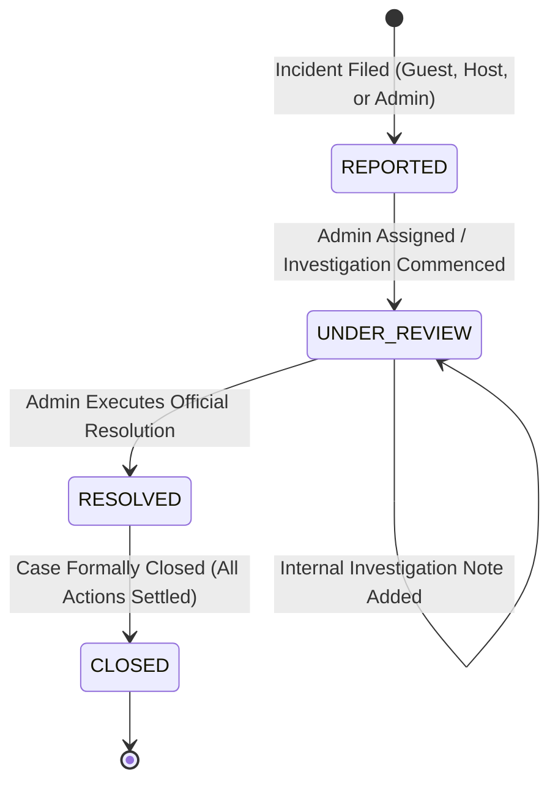

# Phase 12: Dispute, Complaint & Resolution Management

## 1. Executive Overview

Phase 12 implements an enterprise-grade **Dispute, Complaint, and Resolution Management** system for Homyz (`services/dispute.service.ts` and `/admin/bookings/disputes`).

It empowers platform administrators to mediate guest-host conflicts, property damage claims, cleanliness issues, listing misrepresentations, and cancellation disputes through a fair, transparent, and auditable case management workflow.

---

## 2. Architecture & Data Model

To maintain database stability and avoid disruptive schema modifications, Phase 12 leverages the existing `ListingQualityIncident` model in `prisma/schema.prisma`, which naturally links:
- `bookingId`: Direct foreign key to the affected `Booking`.
- `listingId`: Direct foreign key to the associated `Listing`.
- `reportedById`: Direct foreign key to the initiating `User`.
- `category`: Complaint category enum (`DAMAGES`, `CANCELLATION`, `SAFETY`, `LISTING_MISREPRESENTATION`, `CLEANLINESS`, `NOISE_DISTURBANCE`, `OTHER`).
- `status`: Incident lifecycle state (`REPORTED`, `UNDER_REVIEW`, `RESOLVED`, `CLOSED`).
- `severity`: Urgency classification (`LOW`, `MEDIUM`, `HIGH`, `CRITICAL`).
- `metadata`: Extensible structured JSON storing case operational data:
  - `caseReference`: Human-readable identifier (e.g. `DSP-2026-XXXX`).
  - `assignedAdmin`: Currently assigned investigator (`id`, `email`, `assignedAt`).
  - `internalNotes`: Confidential administrator notes and investigative findings (hidden from guest/host).
  - `infoRequests`: Formal requests for evidence or clarification sent to guest or host.
  - `evidence`: Uploaded photos, videos, and receipts.
  - `timeline`: Immutable audit trail of every case event.
  - `resolution`: Formal decision details, financial adjustment notes, and linked refund request IDs.

---

## 3. Dispute Lifecycle & State Machine

### 3.1 Decision Categories

When an administrator resolves a case via `resolveDispute()`, they must classify the outcome into one of the following business decisions:

| Decision Category | Description | Financial Implication |
| :--- | :--- | :--- |
| `REFUND_ISSUED` | Dispute decided in guest's favor due to verifiable property defect. | Generates or references a `BookingRefund` request. |
| `PAYOUT_UPHELD` | Host acted within platform terms; dispute dismissed in host's favor. | Releases host payout hold (`ELIGIBLE_SETTLEMENT`). |
| `SPLIT_SETTLEMENT` | Compromise agreement (e.g. host covers partial cleaning discount). | Accompanied by proportional refund and host earnings adjustment. |
| `CLAIM_DISMISSED` | Frivolous, unproven, or unsubstantiated claim. | No financial adjustment; hold released. |
| `WARNING_ISSUED` | Policy violation identified; formal warning issued to violating party. | Potential quality score penalty; case documented. |
| `MUTUAL_AGREEMENT` | Guest and host agreed on a resolution out-of-band. | Terms documented and filed. |

---

## 4. Investigative Controls & Privacy Safeguards

1. **Internal Notes Confidentiality**:
   Investigative deliberations recorded in `metadata.internalNotes` are accessible **only to administrators**. Public and guest/host views strictly filter out these records to preserve objective deliberation integrity.
2. **Audit Timeline**:
   Every state transition, assignment, information request, and resolution automatically appends an event to `metadata.timeline` and records an immutable entry in the platform `AuditLog` table.
3. **Financial Linkage**:
   If a dispute requires a guest reimbursement, administrators provide the corresponding `refundRequestId` from Phase 10. This ensures that refunds are executed through the authorized, idempotency-protected refund engine rather than via arbitrary balance adjustments.

---

## 5. API Endpoints

All endpoints enforce server-side RBAC guards via `requireApiPermission`:

| Method | Endpoint | Description | Required Permission |
| :--- | :--- | :--- | :--- |
| `GET` | `/api/v1/admin/bookings/disputes` | Paginated disputes list with server-side filters (tab, search, category, status, severity, dates, sorting) | `disputes.view` / `bookings.view` |
| `POST` | `/api/v1/admin/bookings/disputes` | File a new dispute case linked to an existing booking | Admin or Authorized Guest/Host |
| `GET` | `/api/v1/admin/bookings/disputes/summary` | 8 aggregate KPI cards (Active Cases, Investigating, Resolved, Critical, Severity Counts) | `disputes.view` / `bookings.view` |
| `GET` | `/api/v1/admin/bookings/disputes/[id]` | Full dispute case details including parties, evidence, notes, and activity timeline | `disputes.view` / `bookings.view` |
| `POST` | `/api/v1/admin/bookings/disputes/[id]/assign` | Assigns an administrator investigator to the case | `disputes.manage` / `bookings.manage` |
| `POST` | `/api/v1/admin/bookings/disputes/[id]/notes` | Adds a confidential internal investigative note | `disputes.manage` / `bookings.manage` |
| `POST` | `/api/v1/admin/bookings/disputes/[id]/request-info` | Dispatches an information request to the guest or host | `disputes.manage` / `bookings.manage` |
| `POST` | `/api/v1/admin/bookings/disputes/[id]/resolve` | Executes official case resolution with decision category and financial notes | `disputes.resolve` / `disputes.manage` |
| `POST` | `/api/v1/admin/bookings/disputes/[id]/close` | Formally closes a resolved case with closing remarks | `disputes.resolve` / `disputes.manage` |

---

## 6. User Interface & Layout Contracts

### 6.1 Disputes Dashboard (`/admin/bookings/disputes`)
- **8 KPI Cards**: Total Cases, Reported, Under Review, Resolved, Closed, Critical Priority, High Priority, Damages Claims.
- **5 Status Tabs**: All Cases, Reported, Under Review, Resolved, Closed.
- **Filters**: Category dropdown, Severity dropdown, Debounced Search by case reference, booking ID, or user email.
- **"File New Case" Modal**: Full modal form with `ModalOverlay` body scroll locking, validating booking ID, category, severity, and incident details.

### 6.2 Dispute Case Details View (`/admin/bookings/disputes/[id]`)
- **2-Column Responsive Layout**:
  - **Left Column**: Complaint description, Category & Severity badges, Reporter details, Uploaded evidence gallery, Official Resolution card (when resolved), and Complete Chronological Activity Timeline.
  - **Right Column**: Linked Booking card with dates and guests, Financial Context card with captured and refund totals, and Confidential Internal Investigation Notes panel with an instant "+ Add Note" composer.
- **Interactive Modals**:
  - Assign Case Modal
  - Request Info Modal (targeting Guest or Host)
  - Resolve Dispute Modal (with decision category, explanation, and refund linkage)
  - All modals strictly utilize `ModalOverlay` from `@/components/ui/modal-overlay` with body scroll locking.

