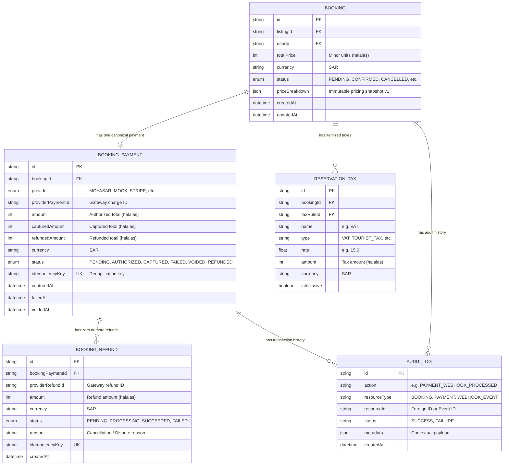
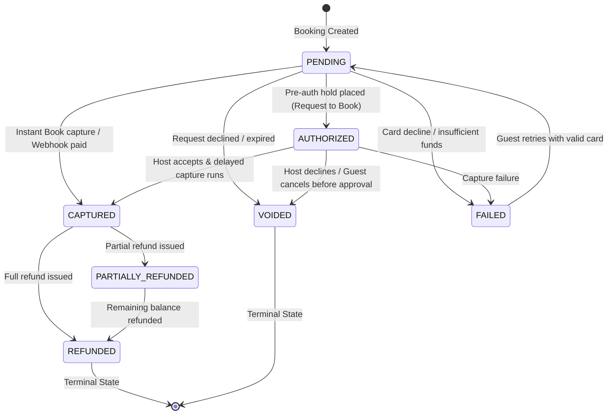

# HOMYZ — FINANCIAL DATA MODEL & LEDGER INTEGRITY SPECIFICATION

**Schema Version:** Prisma Engine 7.10  
**Currency Standard:** ISO 4217 `SAR`  
**Arithmetic Precision:** Strict Minor Units (Integers, Halalas, `1 SAR = 100 Halalas`)  
**Concurrency Protection:** PostgreSQL Session / Transaction Advisory Locks  

---

## 1. Entity-Relationship Architecture

The financial domain in Homyz is modeled through five tightly coupled relational models: `Booking`, `BookingPayment`, `BookingRefund`, `ReservationTax`, and `AuditLog`.



---

## 2. Core Model Definitions & Financial Fields

### 2.1 `Booking`
- `totalPrice` (Int): Authoritative guest total in integer halalas. Computed exclusively by `pricingService.calculateBookingPrice()`. Never derived from client requests.
- `currency` (String): Fixed to `"SAR"`.
- `priceBreakdown` (JSON): Immutable historical pricing snapshot. Preserves stay subtotal, nightly breakdown, winning discount details, itemized fees, taxes, and host payout breakdowns.

### 2.2 `BookingPayment`
- `id` (String): Unique transaction identifier (`nanoid`).
- `bookingId` (String): Unique 1-to-1 foreign key to `Booking`.
- `provider` (PaymentProvider Enum): `MOYASAR`, `MOCK`, `STRIPE`, etc.
- `providerPaymentId` (String): The gateway's unique transaction identifier.
- `amount` (Int): The initial authorized transaction amount in halalas.
- `capturedAmount` (Int): The actual amount settled from the guest's card.
- `refundedAmount` (Int): The cumulative sum of all approved refunds (`<= capturedAmount`).
- `status` (PaymentStatus Enum): Current state of funds.
- `idempotencyKey` (String, Unique): Ensures network retries or duplicate button clicks cannot generate duplicate charge transactions.

### 2.3 `BookingRefund`
- `bookingPaymentId` (String): Links the refund directly to the originating payment transaction.
- `amount` (Int): Refund amount in halalas.
- `status` (RefundStatus Enum): `PENDING`, `PROCESSING`, `SUCCEEDED`, or `FAILED`.
- `idempotencyKey` (String, Unique): Prevents duplicate refund issuance for the same request.

### 2.4 `ReservationTax`
- Stores individual tax lines (such as 15% ZATCA VAT or municipal tourism fees) calculated at booking creation.
- Immutable reference guaranteeing auditability even if platform or host tax settings change in the future.

---

## 3. Financial Status State Machine

The lifecycle of funds strictly adheres to the following transition graph:



### State Transition Validation Table

| Prior Status | Target Status | Permitted Trigger | Invariant Enforced |
|---|---|---|---|
| `PENDING` | `AUTHORIZED` | Pre-auth hold succeeds | `amount > 0`, `capturedAmount == 0` |
| `PENDING` | `CAPTURED` | Instant Book / Webhook `payment.paid` | `capturedAmount == amount` |
| `PENDING` | `VOIDED` | Booking request declined or expired | Zero funds captured |
| `AUTHORIZED` | `CAPTURED` | Host accepts reservation | `capturedAmount > 0` |
| `AUTHORIZED` | `VOIDED` | Host declines / Guest cancels | Pre-auth released at gateway |
| `CAPTURED` | `PARTIALLY_REFUNDED` | Policy-based partial refund | `0 < refundedAmount < capturedAmount` |
| `CAPTURED` | `REFUNDED` | Full cancellation refund | `refundedAmount == capturedAmount` |
| `PARTIALLY_REFUNDED` | `REFUNDED` | Secondary refund for remainder | `refundedAmount == capturedAmount` |
| `REFUNDED` | `CAPTURED` | **FORBIDDEN** | Terminal state; funds cannot be un-refunded. |
| `VOIDED` | `CAPTURED` | **FORBIDDEN** | Terminal state; voided auth cannot be captured. |

---

## 4. Immutable Pricing Snapshot Schema (`v1`)

When a booking is confirmed, the full quote is stored in `Booking.priceBreakdown` under schema version `v1`:

```json
{
  "version": "v1",
  "revision": 1,
  "currency": "SAR",
  "nights": 3,
  "guests": 2,
  "baseNightlyPrice": 50000,
  "staySubtotal": 150000,
  "discountAmount": 0,
  "accommodationSubtotal": 150000,
  "cleaningFee": 5000,
  "petFee": 3000,
  "extraGuestFee": 0,
  "totalAdditionalFees": 8000,
  "hostServiceFeePercentage": 15,
  "hostServiceFee": 22500,
  "taxTotal": 23700,
  "guestTotal": 181700,
  "storedTotal": 181700,
  "payoutBreakdown": {
    "accommodationSubtotal": 150000,
    "extraGuestFee": 0,
    "petFee": 3000,
    "cleaningFee": 5000,
    "taxesCollectedForHost": 0,
    "taxesRemittedByPlatform": 23700,
    "platformServiceFee": 22500,
    "netHostPayout": 135500,
    "currency": "SAR"
  },
  "breakdown": [
    { "date": "2026-11-01", "price": 50000, "isWeekend": false, "rateSource": "WEEKDAY" },
    { "date": "2026-11-02", "price": 50000, "isWeekend": false, "rateSource": "WEEKDAY" },
    { "date": "2026-11-03", "price": 50000, "isWeekend": false, "rateSource": "WEEKDAY" }
  ],
  "cancellationPolicy": "MODERATE",
  "snapshotCreatedAt": "2026-10-14T11:30:00.000Z"
}
```

### Mathematical Invariants:
1. `guestTotal = accommodationSubtotal + totalAdditionalFees + taxTotal`
2. `netHostPayout = accommodationSubtotal + totalAdditionalFees - hostServiceFee + taxesCollectedForHost`
3. `hostServiceFee = Math.round(accommodationSubtotal * (hostServiceFeePercentage / 100))`
4. `taxableBase = accommodationSubtotal + totalAdditionalFees` (strictly excludes `hostServiceFee`)

---

## 5. Concurrency Control & Advisory Locks

To prevent race conditions during high-concurrency booking attempts or duplicate webhook events, Homyz utilizes PostgreSQL transaction advisory locks:

```sql
-- Lock listing during date reservation
SELECT pg_advisory_xact_lock(hashtext(concat('listing:', listingId)));

-- Lock payment record during webhook state transition
SELECT pg_advisory_xact_lock(hashtext(paymentId));
```

Advisory locks are automatically released upon transaction commit or rollback, preventing deadlocks while guaranteeing strict serializability.

