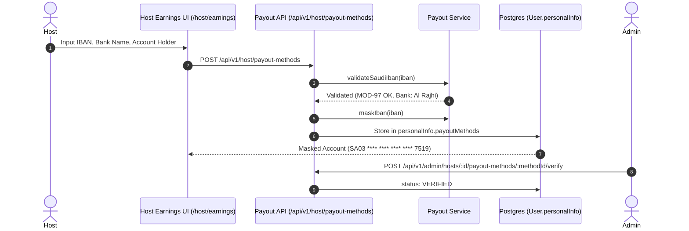
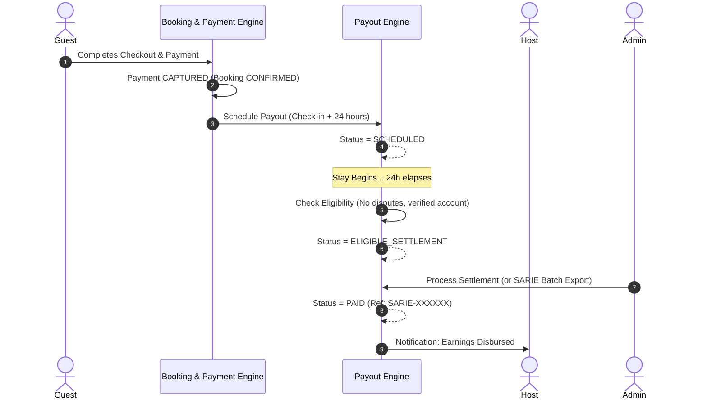
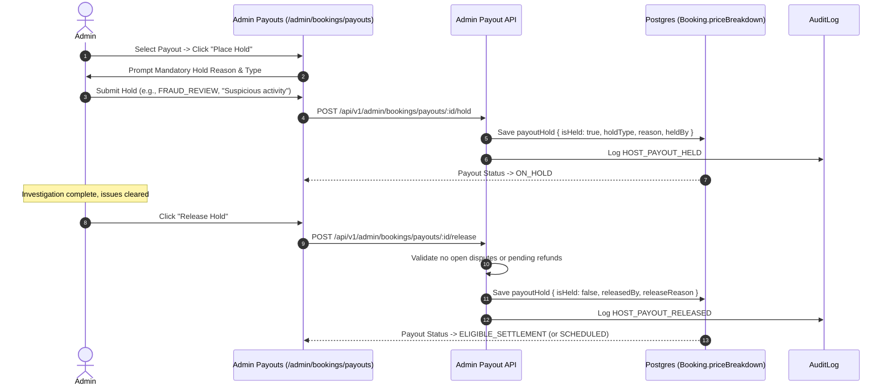

# HOMYZ — HOST PAYOUT WORKFLOWS & OPERATIONAL PROCEDURES

## 1. Host Payout Account Onboarding Workflow

1. **Host Input:** Host navigates to `/host/earnings` and clicks `+ Add Payout Method`.
2. **MOD-97 & Bank Code Verification:** System validates that IBAN starts with `SA`, has 24 characters, and satisfies international mod-97 remainder equal to 1. Resolves bank name automatically.
3. **Data Sanitization & Masking:** IBAN is masked to protect sensitive account details.
4. **Admin Review:** Admin verifies that the beneficiary name matches the Host's verified KYC government identity.

---

## 2. Reservation Payout Lifecycle & Scheduling Workflow

1. **Reservation Confirmation:** Once Guest payment is captured, the system records `priceBreakdown.payoutBreakdown` and computes scheduled release timestamp (`booking.startDate + 24h`). Status is `SCHEDULED`.
2. **Release Check:** Upon arrival of scheduled timestamp, the eligibility engine evaluates 7 conditions:
   - Confirmed booking status
   - Captured payment
   - Check-in + 24h passed
   - No active disputes (`ListingQualityIncident`)
   - No open refunds (`BookingRefund`)
   - Verified default payout method configured
   - No administrative hold active
3. If all criteria pass, status transitions to `ELIGIBLE_SETTLEMENT`.

---

## 3. Administrative Hold & Release Workflow

---

## 4. Corporate Banking SARIE Settlement & Batch Export Workflow

Because acquiring payment gateways (such as Moyasar) do not provide direct host bank disbursement rails in Saudi Arabia:
1. Payouts in `ELIGIBLE_SETTLEMENT` status represent verified platform financial readiness.
2. The Admin clicks **SARIE Batch Export** on `/admin/bookings/payouts`.
3. An authoritative CSV file is generated conforming to Saudi corporate banking format:
   - `Booking Reference`
   - `Beneficiary Name`
   - `Beneficiary IBAN`
   - `Bank Name`
   - `Amount SAR`
   - `Currency`
   - `Scheduled Date`
   - `Property Title`
   - `Status`
4. Admin uploads the batch file to the corporate banking portal (e.g. Al Rajhi Corporate / SNB e-Corp).
5. Upon confirmation, Admin executes settlement via `/api/v1/admin/bookings/payouts/:id/process`, assigning an authoritative `SARIE-XXXXXXXX` reference and locking the record as `PAID`.

