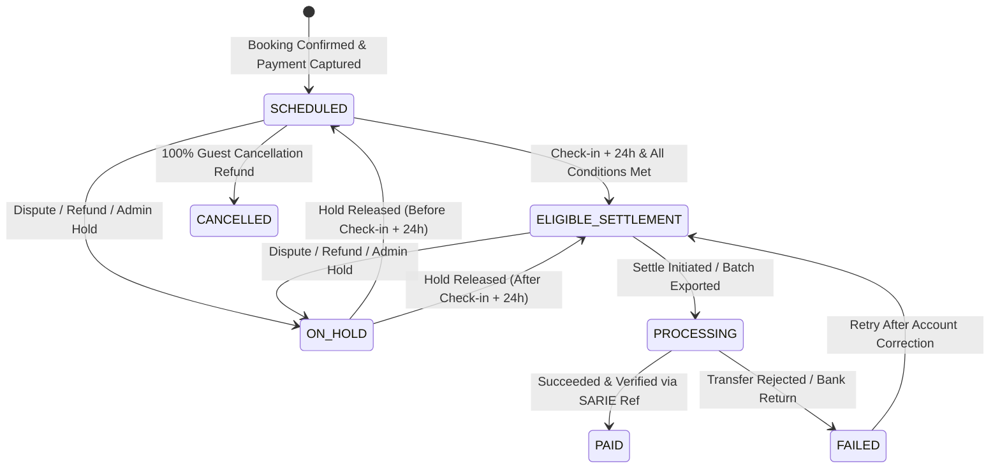

# HOMYZ — MODULE 4: HOST PAYOUT MANAGEMENT ARCHITECTURE AUDIT

## 1. Executive Summary

Module 4 establishes an authoritative, reliable, and secure Host Earnings and Payout Management system for Homyz. The architecture bridges reservation financials, payment collection, cancellation adjustments, dispute resolutions, and marketplace host disbursements.

This audit details the foundational findings, gateway constraints, regulatory banking standards in the Kingdom of Saudi Arabia, and the end-to-end mechanisms implemented across Phases 13–18.

---

## 2. Payment Provider Capabilities & Payout Rails Audit

### 2.1 Provider Analysis: Moyasar
- **Provider Role:** Saudi Arabian Acquiring Payment Gateway (licensed by Saudi Central Bank — SAMA).
- **Core Operations Supported:**
  - Card acquiring: Mada, Visa, MasterCard, Apple Pay.
  - Payment authorization, manual/delayed capture, partial capture, voiding, and refunds.
- **Marketplace Payout Capabilities Matrix:**
  - `marketplaceSplitPayments`: **FALSE** (Standard Moyasar does not perform automated splitting to third-party sub-merchants).
  - `connectedHostAccounts`: **FALSE** (No host merchant onboarding or sub-account API like Stripe Connect).
  - `hostTransfersPayouts`: **FALSE** (Acquiring gateway only; does not provide direct host bank transfer rails).
  - `payoutStatusTracking`: **FALSE** (No external payout transfer webhooks).

### 2.2 Saudi Corporate Banking Rails (SARIE)
In accordance with SAMA guidelines and marketplace best practices in Saudi Arabia:
1. Guest payment collection occurs through the acquiring gateway (Moyasar).
2. Funds settle into the Homyz corporate merchant bank account.
3. Host disbursements are executed via Saudi Arabian Riyal Interbank Express (`SARIE`) / local corporate banking B2B rails (e.g. Al Rajhi, SNB B2B portal batch files).
4. **Architectural Realism:** The system does not fabricate provider API transfers or mark money as moved without verified execution. It manages the full lifecycle: `SCHEDULED` → `ELIGIBLE_SETTLEMENT` → `PROCESSING` → `PAID` with batch corporate banking SARIE export and verified execution tracking.

---

## 3. Host Payout Account Data Model & Validation (Phase 13)

### 3.1 Account Model
Host payout methods are structured securely within `User.personalInfo.payoutMethods`:
```typescript
export interface HostPayoutMethod {
  id: string; // pm_xxxxxxxxxxxx
  accountHolderName: string;
  bankName: string;
  bankCode?: string;
  ibanMasked: string; // SA03 **** **** **** **** 7519
  ibanLast4: string;
  ibanFormatted?: string;
  routingCode?: string;
  currency: string; // SAR
  isDefault: boolean;
  status: "VERIFIED" | "PENDING_VERIFICATION" | "REJECTED";
  verifiedAt?: string;
  rejectionReason?: string;
  createdAt: string;
  updatedAt: string;
}
```

### 3.2 Saudi IBAN MOD-97 Checksum & Bank Code Resolution
- Saudi IBANs must start with `SA`, followed by 2 check digits, 2 bank code digits, and 18 account digits (24 characters total).
- The system enforces international ISO 13616 / ISO 7064 MOD-97-10 checksum validation.
- Auto-resolves commercial bank entities via the 2-digit bank code:
  - `80`: Al Rajhi Bank (مصرف الراجحي)
  - `10`: Saudi National Bank (SNB / الأهلي)
  - `20`: Riyad Bank (بنك الرياض)
  - `05`: Alinma Bank (مصرف الإنماء)
  - `50`: Banque Saudi Fransi (البنك السعودي الفرنسي)
  - `45`: SAB (Saudi Awwal Bank / البنك السعودي الأول)
  - `15`: Bank AlJazira (بنك الجزيرة)
  - `65`: The Saudi Investment Bank (البنك السعودي للاستثمار)
  - `55`: Bank AlBilad (بنك البلاد)
  - `30`: Arab National Bank (البنك العربي الوطني)

### 3.3 Security & Masking
- Raw full IBANs are never exposed in UI or standard client API payloads.
- Masking standard: `SA03 **** **** **** **** 7519`.
- Identity check: Host legal name from verified identity verification is matched against beneficiary account holder name.

---

## 4. Authoritative Host Earnings Engine (Phase 14)

### 4.1 Calculation Formula
$$\text{Gross Earnings} = \text{Accommodation Subtotal} + \text{Extra Guest Fee} + \text{Pet Fee} + \text{Cleaning Fee}$$
$$\text{Platform Commission} = \text{Host Service Fee (15\%)}$$
$$\text{Net Host Payout} = \text{Gross Earnings} - \text{Platform Commission}$$

### 4.2 Single Source of Truth
- Source of Truth: The committed `priceBreakdown.payoutBreakdown` snapshot on the `Booking` record.
- Historical bookings are never recalculated using live property rates.
- Legacy bookings lacking snapshots safely use the recorded nightly subtotal and cleaning fee with platform fee deduction.
- All monetary values are maintained in integer minor units (halalas / cents) to prevent rounding drift.

---

## 5. Payout Eligibility & Scheduling State Machine (Phase 15)

### 5.1 Eligibility Criteria
A booking payout is eligible for disbursement if and only if **all** 7 conditions are satisfied:
1. Booking status is `CONFIRMED`.
2. Guest payment status is `CAPTURED` (or full payment captured).
3. Scheduled payout date has arrived (Check-in date + 24 hours).
4. No active open dispute or quality incident (`ListingQualityIncident` in `PENDING` or `CONFIRMED`).
5. No pending or processing guest refund request (`BookingRefund`).
6. Host has a verified default payout method configured.
7. No active administrative hold (`payoutHold.isHeld !== true`).

### 5.2 State Machine


---

## 6. Admin & Host Dashboards Audit (Phase 17)

### 6.1 Admin Payout Dashboard (`/admin/bookings/payouts`)
- **8 KPI Metrics:**
  1. Total Paid Volume
  2. Total Paid Count
  3. Eligible for Settlement Volume
  4. Eligible for Settlement Count
  5. Scheduled / Pending Stay Volume
  6. Scheduled / Pending Stay Count
  7. On Hold Volume
  8. On Hold Count
- Actions: Hold Payout, Release Hold, Process Settlement, Export SARIE CSV.
- Compliant with `ModalOverlay` reference-counted scroll-locking and design system.

### 6.2 Host Earnings Dashboard (`/host/earnings`)
- Dedicated Host earnings center:
  - Total Paid Out, Upcoming Payouts, Eligible for Settlement, On Hold amounts.
  - Payout Methods manager (Add IBAN, Set Default, Remove).
  - Upcoming vs. Completed reservations tabs.
  - CSV export statement for host tax and accounting records.

---

## 7. Refunds, Disputes & Post-Payout Recovery (Phase 18)

- **Pre-Payout Refund:** Guest cancellation adjusts `cancellation.hostPayoutRetained`. If 100% refund, host payout is 0 and status is `CANCELLED`.
- **Post-Payout Refund / Clawback:** If refund occurs after payout is `PAID`, historical settled record remains untouched. A `REFUND_DEDUCTION` or `DISPUTE_CLAWBACK` record is logged in the Host's adjustment ledger and deducted from future eligible earnings.

