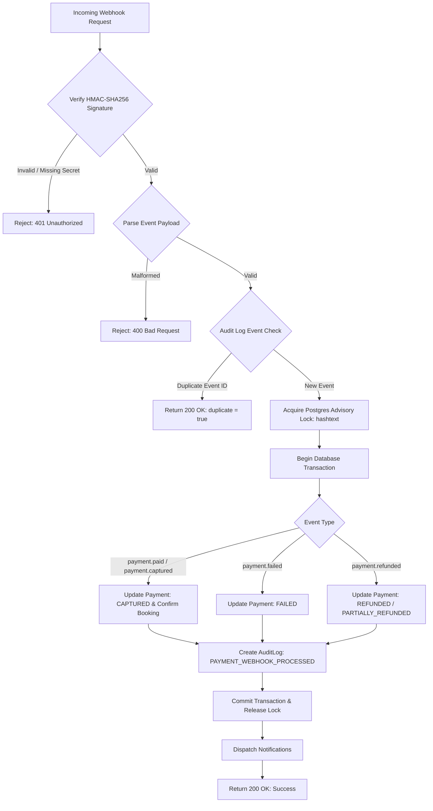

# HOMYZ — PAYMENT GATEWAY CAPABILITIES & INTEGRATION SPECIFICATION

**Target Payment Gateway:** Moyasar  
**Jurisdiction:** Kingdom of Saudi Arabia (SAMA Regulated)  
**API Specification:** RESTful API v1 (`https://api.moyasar.com/v1`)  
**Interface Implementation:** `lib/payment/moyasar-adapter.ts` (`PaymentProviderInterface`)  
**Current Mode:** `DEFERRED` / `MOCK` (Safety Sandbox)  

---

## 1. Provider Overview & Payment Methods

Moyasar is the leading Saudi Arabian payment gateway approved by the Saudi Central Bank (SAMA). It provides direct integration into local debit networks (`mada`), international credit cards (`Visa`, `Mastercard`), and mobile wallets (`Apple Pay`).

### Supported Payment Methods in KSA
- **mada:** Saudi Arabia's national domestic debit card scheme. Required for high-conversion e-commerce in KSA.
- **Visa & Mastercard:** International and domestic credit/debit transactions.
- **Apple Pay:** High-speed web checkout using encrypted device tokens.
- **Sadad / STC Pay:** Direct invoice and digital wallet payments (note: unsupported for delayed authorization holds).

### Configuration & Environment Variables

| Variable | Required In | Description |
|---|---|---|
| `MOYASAR_API_KEY` | Production / Live Sandbox | Secret API key used for HTTP Basic Authentication. Must NEVER be exposed to frontend or client bundles. |
| `MOYASAR_WEBHOOK_SECRET` | Production / Live Sandbox | Shared secret key used for HMAC-SHA256 signature verification on incoming webhooks. |
| `MOYASAR_API_URL` | Optional | Custom base endpoint (defaults to `https://api.moyasar.com/v1`). |
| `PAYMENT_MODE` | All | Operating mode: `MOCK`, `DEFERRED`, or `ONLINE_AUTHORIZATION`. |

> [!CAUTION]
> Live payment credentials must never be committed to git. In accordance with PCI-DSS requirements, raw primary account numbers (PAN) and CVV codes are never handled or stored on Homyz application servers; tokenization occurs on the gateway client layer.

---

## 2. Gateway Capability Verification Matrix

| Capability | Status | Detailed Verification Notes |
|---|---|---|
| **Create Payment** | **VERIFIED SUPPORTED** | Supported via `POST /v1/payments` with source types `creditcard`, `mada`, and `applepay`. Verified in `MoyasarAdapter.createPayment()`. |
| **Payment Authorization** | **VERIFIED SUPPORTED** | Supported via `capture: false` flag during payment creation on credit cards and mada. Verified in unit tests. |
| **Delayed Capture** | **VERIFIED SUPPORTED** | Supported via `POST /v1/payments/{id}/capture` within the standard 7-day card authorization window. |
| **Partial Capture** | **VERIFIED SUPPORTED** | Supported via `POST /v1/payments/{id}/capture` specifying an explicit integer `amount` parameter in halalas. |
| **Authorization Void** | **VERIFIED SUPPORTED** | Supported via `POST /v1/payments/{id}/void`. Releases authorization hold immediately before capture with zero merchant interchange penalty. |
| **Full Refund** | **VERIFIED SUPPORTED** | Supported via `POST /v1/payments/{id}/refund` for settled/captured charges. Verified in unit tests. |
| **Partial Refund** | **VERIFIED SUPPORTED** | Supported via `POST /v1/payments/{id}/refund` with an `amount` parameter in minor units (halalas). Multiple partial refunds are permitted up to captured total. |
| **Refund Status Webhooks** | **VERIFIED SUPPORTED** | Supported via asynchronous webhook event `payment.refunded` with HMAC-SHA256 verification. |
| **Payment Status Webhooks** | **VERIFIED SUPPORTED** | Supported via webhook events: `payment.paid`, `payment.failed`, `payment.captured`. Fully normalized in `MoyasarAdapter.parseWebhookEvent()`. |
| **Marketplace Split Payments** | **UNSUPPORTED** | Standard Moyasar merchant accounts do not support automatic split payments to host sub-accounts at charge capture time. Platform collects 100% of guest funds. |
| **Connected Host Accounts** | **UNSUPPORTED** | Moyasar does not provide an automated Stripe Connect-style sub-merchant onboarding API in KSA. Host banking details are stored securely in Homyz database. |
| **Host Transfers / Payouts** | **UNSUPPORTED** | Moyasar is an acquiring payment gateway only. Host payouts must be executed via Saudi corporate banking (SARIE local bank transfers) or automated payroll/disbursement APIs. |
| **Payout Status Tracking** | **UNSUPPORTED** | Host payout execution cannot be tracked through Moyasar API. Status is tracked authoritatively in Homyz admin settlement layer (`services/analytics-admin.service.ts`). |
| **Payment Reconciliation** | **SUPPORTED UNTESTED** | Moyasar invoices API (`/v1/invoices`) and monthly settlement reports are available in the merchant portal; automated API polling requires live production activation. |
| **Idempotency Keys** | **VERIFIED SUPPORTED** | Homyz database enforces strict uniqueness on `BookingPayment.idempotencyKey` and `BookingRefund.idempotencyKey`. |

---

## 3. Request-to-Book Compatibility & Timing Analysis

In a Request-to-Book workflow, the guest initiates a reservation request that the host must approve before the booking is confirmed. 

### The 7-Day Authorization Window
- **Gateway Limit:** Credit cards and mada authorizations in KSA hold funds for up to **7 calendar days (168 hours)**. If capture is not executed within 7 days, the acquiring bank automatically drops the hold, returning the funds to the cardholder's available credit.
- **Homyz Host Response Window:** Homyz enforces a **24 to 48-hour host decision window**. Because 48 hours is well within the 7-day gateway limit, delayed capture is fully compatible with our Request-to-Book flow.
- **Host Decline / Guest Cancellation:** If the host declines or the request expires after 48 hours, the system immediately invokes `voidAuthorization()`, releasing the funds with zero processing fees.
- **Unsupported Methods for Request to Book:** Payment methods that do not support two-step pre-authorization (such as Sadad or cash) cannot be used for Request to Book; checkout enforces card or Apple Pay authorization holds for pending requests.

---

## 4. Payment Webhook Ingress & Idempotency Engine

Payment webhooks are handled by `services/payment-webhook.service.ts` and exposed via endpoints `app/api/v1/payments/webhooks/route.ts` and `app/api/v1/payments/webhooks/moyasar/route.ts`.

### Security & Idempotency Features:
1. **Timing-Safe HMAC Verification:** Verification uses `crypto.timingSafeEqual` over SHA-256 HMAC digests, guarding against timing analysis vulnerabilities.
2. **PostgreSQL Advisory Locks:** `SELECT pg_advisory_xact_lock(hashtext(payment.id))` serializes concurrent webhook deliveries for the same payment, eliminating race conditions.
3. **Audit-Log-Backed Deduplication:** Incoming `eventId` is recorded in `AuditLog` under `WEBHOOK_EVENT`. Retried webhook deliveries from Moyasar are recognized immediately and answered with `200 OK` without repeating database mutations.
4. **Out-of-Order Safety:** If a `payment.captured` event arrives after the payment is already marked `CAPTURED`, the update returns idempotently without redundant booking updates.

---

## 5. Security Architecture & Invariants

1. **Server-Side Authority:** The client checkout bundle *never* calculates or passes payment amounts to the payment gateway. The server calculates the exact quote from database records and passes the authoritative amount directly to the gateway.
2. **Mismatch Detection:** If the guest's optimistic total (`expectedGuestTotal`) does not match the server quote down to the halala, the API aborts with a `409 PRICE_CHANGED` error before any gateway call is attempted.
3. **Zero Raw Card Storage:** Credit card details are tokenized by Moyasar.js directly in the browser; Homyz only stores gateway tokens, the last 4 digits, and the card brand for receipt rendering.
4. **Fail-Closed Strategy:** When API keys are missing or unconfigured, all adapter methods fail closed with structured error codes (`MOYASAR_NOT_CONFIGURED`) rather than proceeding or faking success.

