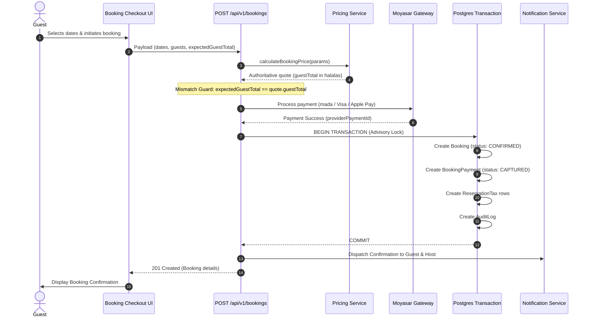
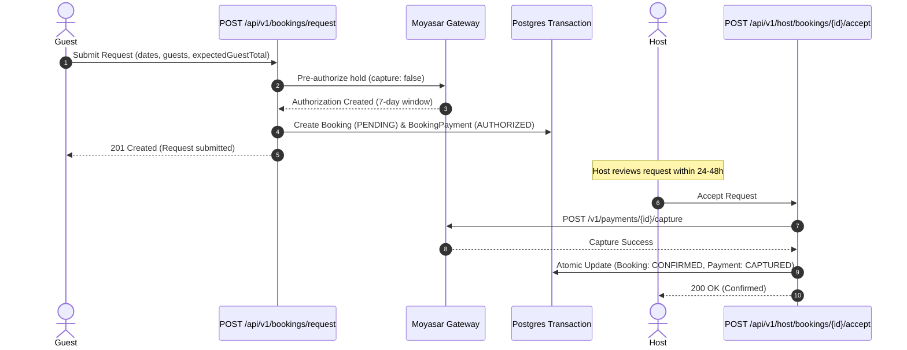
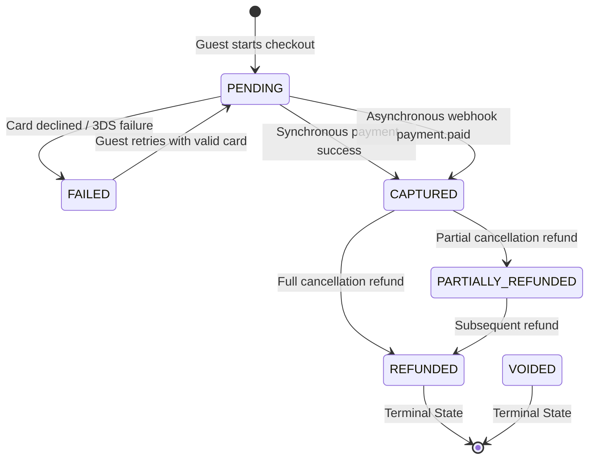

# HOMYZ — PAYMENT WORKFLOWS & TRANSACTION LIFECYCLES

**Target Payment Gateway:** Moyasar  
**Currency Standard:** `SAR` (Minor units / Halalas)  
**Security Level:** SAMA-Compliant / PCI-DSS Tokenized  

---

## 1. Instant Book Workflow

Instant Book reservations bypass host approval, confirming the stay and capturing payment in a single atomic transaction.

### Recovery Conditions:
- **Price Discrepancy:** If `expectedGuestTotal !== quote.guestTotal`, the API aborts with `409 PRICE_CHANGED` without creating any charge or booking record.
- **Card Decline:** If the gateway declines the card, the transaction aborts with `400 PAYMENT_FAILED`. No booking or inventory hold is created.
- **Double Submission:** The client submits `requestSubmissionId`. If duplicate submission arrives, `findUnique({ submissionId })` intercepts it and returns the existing booking safely.

---

## 2. Request to Book Workflow (Pre-Auth & Host Approval)

Request to Book allows the host 24 to 48 hours to review the reservation request while funds are held via pre-authorization.

---

## 3. Host Rejection & Expiration Workflows

When a request is rejected by the host or passes the 24-hour response deadline without action, the hold is released immediately.

### 3.1 Host Rejection Flow
1. **Trigger:** Host clicks "Decline Request" on `/host/bookings/[id]`.
2. **Gateway Action:** Server dispatches `POST /v1/payments/{id}/void` to Moyasar to cancel the authorization hold.
3. **Database Transaction:**
   - `Booking.status` updates to `CANCELLED` (reason: `HOST_DECLINED`).
   - `BookingPayment.status` updates to `VOIDED` with `voidedAt = new Date()`.
   - Temporary inventory calendar holds are released.
4. **Notifications:** Guest receives immediate notification explaining the host declined the request.

### 3.2 Request Expiration Flow
1. **Trigger:** Automated hourly cron (`POST /api/v1/bookings/expire-stale`) or lazy evaluation upon detail view.
2. **Precondition:** `Booking.status === PENDING` and `createdAt <= (now - 24 hours)`.
3. **Gateway Action:** Server dispatches `POST /v1/payments/{id}/void`.
4. **Database Transaction:**
   - `Booking.status` updates to `CANCELLED` (reason: `EXPIRED`).
   - `BookingPayment.status` updates to `VOIDED` with `voidedAt = new Date()`.
   - Inventory dates are released back to public availability.
5. **Notifications:** Guest receives notification: *"Your booking request expired because the host did not respond within 24 hours."*

---

## 4. Payment Failure & Delayed Webhook Confirmation

### Delayed Webhook Confirmation Handling
In scenarios where 3D-Secure card authentication redirects the user or network drops before the client receives the synchronous response:
1. Moyasar dispatches `payment.paid` or `payment.captured` webhook event.
2. Ingress endpoint (`POST /api/v1/payments/webhooks/moyasar`) authenticates the HMAC signature using `crypto.timingSafeEqual`.
3. Advisory lock (`pg_advisory_xact_lock`) prevents race conditions between simultaneous webhooks.
4. If the payment is already `CAPTURED`, the event is recognized as idempotent and acknowledges with `200 OK`.
5. If the payment is still `PENDING`, it is atomically updated to `CAPTURED`, and `Booking.status` is transitioned to `CONFIRMED`.
6. Notifications are dispatched to both the guest and the host.

