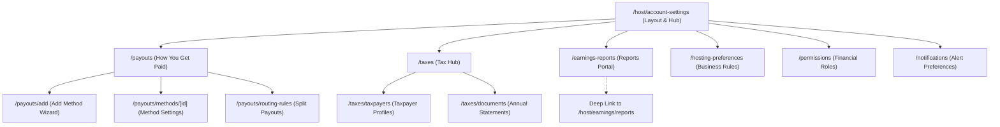
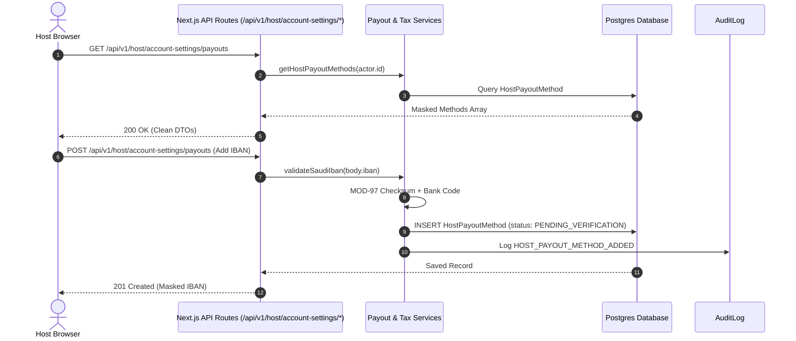

# HOMYZ — HOST ACCOUNT SETTINGS ARCHITECTURE SPECIFICATION
## Comprehensive Route Architecture, Data Models, Component Reuse Strategy, Security & Admin Integration

**Document Version:** 1.0.0  
**Architecture Date:** October 26, 2026  
**Auditor Roles:** Senior Full-Stack Architect, FinTech Integration Architect, Database Architect, Product Analyst  
**Target Environment:** Homyz Core Platform (`/media/drive/shihab/Homyz`)  

---

## 1. ARCHITECTURAL OBJECTIVES & GUIDING PRINCIPLES

1. **Clean Separation of Concerns:**
   Host Account Settings (`/host/account-settings`) is strictly decoupled from Guest Profile Management (`/profile`), Public Host Profiles, Property Listing Settings (`/host/listings/[id]`), and the Authoritative Financial Ledger (`/host/earnings`).
2. **Single Financial Source of Truth:**
   All host earnings and payout calculations must strictly derive from the immutable `Booking.priceBreakdown.payoutBreakdown` snapshot. No secondary pricing engine or parallel commission calculation logic may be introduced.
3. **Component & Service Reuse Over Reinvention:**
   Reuse `services/payout.service.ts` for IBAN verification, hold resolution, and settlement calculations. Reuse `services/host-reporting.service.ts` for report data aggregation, CSV generation, and PDF rendering. Reuse existing design system primitives (`Container`, `HostHeader`, `ModalOverlay`, `primaryButtonInteractionClass`).
4. **Normalized Relational Data Models with Safe Migration:**
   Transition host payout accounts, routing rules, taxpayer profiles, and tax documents from unstructured JSON into normalized, indexed relational Prisma models with zero data loss for existing hosts.
5. **Security by Default:**
   All bank account numbers and tax IDs must be masked at rest and in API responses (`maskIban`). No raw credentials or unencrypted financial identifiers may be exposed in client bundles or public APIs.

---

## 2. FINAL ROUTE MAP & PAGE RESPONSIBILITIES

The proposed route hierarchy fits seamlessly into Next.js 15 App Router under the `app/(protected)/host/account-settings` route group:



### Detailed Route Specifications:

| Route Path | Type | Parent Layout | Page Responsibility & Purpose | Required Role / Permission | Data Dependencies |
|---|---|---|---|---|---|
| `/host/account-settings` | New | `HostAccountSettingsLayout` | Dashboard hub featuring high-level cards for all 6 submodules with status badges. | `Role.HOST, Role.ADMIN` | User session, payout method count, tax status summary. |
| `/host/account-settings/payouts` | New | `HostAccountSettingsLayout` | "How You Get Paid": displays list of registered payout accounts, default indicator, verification status pills, add method button. | `Role.HOST, Role.ADMIN` (`earnings.payout`) | `payoutService.getHostPayoutMethods(hostId)` |
| `/host/account-settings/payouts/add` | New | `HostAccountSettingsLayout` | Multi-step wizard: country selection (KSA default), method type (Bank Transfer), account holder, Saudi IBAN input with live checksum validation. | `Role.HOST, Role.ADMIN` (`earnings.payout`) | Country catalog, bank code directory. |
| `/host/account-settings/payouts/methods/[id]` | New | `HostAccountSettingsLayout` | Account detail view: masked IBAN, bank name, beneficiary name, verification status, action buttons (Make Default, Remove). | `Role.HOST, Role.ADMIN` (`earnings.payout`) | Single payout method record. |
| `/host/account-settings/payouts/routing-rules` | New | `HostAccountSettingsLayout` | Payout routing rules: listing-specific payout destination assignment and percentage-based co-host allocation rules. | `Role.HOST, Role.ADMIN` (`earnings.payout`) | Host listings, registered payout methods, co-host assignments. |
| `/host/account-settings/taxes` | New | `HostAccountSettingsLayout` | Tax landing view with tabs for Taxpayers and Tax Documents, plus regulatory guidance for KSA / GCC. | `Role.HOST, Role.ADMIN` | Tax registration summary, annual documents list. |
| `/host/account-settings/taxes/taxpayers` | New | `HostAccountSettingsLayout` | Form and list for taxpayer records: Individual vs Business, Legal Tax Name, Residence Country, VAT/GST Number, Tax ID. | `Role.HOST, Role.ADMIN` | `taxService.getTaxRegistrations(hostId)`. |
| `/host/account-settings/taxes/documents` | New | `HostAccountSettingsLayout` | Repository of yearly tax summary statements (PDF/CSV) and booking tax invoice download links. | `Role.HOST, Role.ADMIN` | Aggregated reservation tax records. |
| `/host/account-settings/earnings-reports` | New | `HostAccountSettingsLayout` | Financial reports summary card explaining reporting periods; deep links directly to `/host/earnings/reports`. | `Role.HOST, Role.ADMIN` (`earnings.view`) | `hostReportingService.getReportsLanding()`. |
| `/host/account-settings/hosting-preferences` | New | `HostAccountSettingsLayout` | Configurable hosting policies: minimum payout threshold (SAR), payout cadence, standard check-in/out rules. | `Role.HOST, Role.ADMIN` | Host preferences entity. |
| `/host/account-settings/permissions` | New | `HostAccountSettingsLayout` | Financial access control: co-host financial permission delegation (view earnings, manage payouts), admin override status. | `Role.HOST, Role.ADMIN` | `listingCoHostService`, `hostPermissionService`. |
| `/host/account-settings/notifications` | New | `HostAccountSettingsLayout` | Notification channel preferences: email/SMS toggles for payout disbursed, payout failed, tax statement ready. | `Role.HOST, Role.ADMIN` | Host notification preferences. |

---

## 3. COMPONENT REUSE STRATEGY

To preserve UI consistency and avoid code duplication:
1. **Header & Shell Navigation:**
   Reuse `HostHeader` (`components/host/host-header.tsx`), which wraps `AppHeader`. In `components/dashboard/app-header.tsx`, update the avatar menu link: when `isHosting` is active, "Account settings" navigates to `/host/account-settings` instead of `/profile/tab/account_settings`.
2. **Page Containers & Layout:**
   Use the established layout classes:
   - Container: `Container` from `components/ui/container.tsx` (`max-w-6xl px-4 sm:px-6`).
   - Breadcrumbs: standard Homyz typography (`text-xs text-zinc-500` with arrow separators).
   - Sidebar: Sticky navigation card matching Airbnb account settings sidebar.
3. **Financial Logic & Validation:**
   - Reuse `validateSaudiIban()` and `maskIban()` from `services/payout.service.ts`.
   - Reuse `SAUDI_BANK_CODES` directory for bank logo / name resolution.
   - Reuse `SimplePdfDocument` (`lib/export/pdf-generator.ts`) for all PDF document generation.
4. **Modals & Overlays:**
   Reuse `ModalOverlay` (`components/ui/modal-overlay.tsx`) for deletion confirmations and routing rule editors.
5. **Design System Tokens:**
   - Brand Amber highlight: `#FCDF9C`
   - Primary dark text: `#1F1F1F`
   - Secondary text: `#727272`
   - Border radius: `rounded-2xl` / `rounded-3xl`
   - Interactive button class: `primaryButtonInteractionClass` from `components/ui/button.tsx`

---

## 4. PROPOSED DATABASE ARCHITECTURE

### 4.1 Deficiencies in Current Storage
Currently, host payout methods are serialized in `User.personalInfo.payoutMethods` as a JSON array. This prevents:
- Unique constraints on IBANs across accounts.
- Database-enforced foreign key relations to listings or bookings.
- Indexing for administrative search and auditing.
- Relational integrity when co-hosts or split routing rules are linked to a payout account.

### 4.2 Proposed Normalized Schema (Prisma)

```prisma
// ============================================================================
// Host Payout & Financial Settings Models
// ============================================================================

enum HostPayoutMethodStatus {
  PENDING_VERIFICATION
  VERIFIED
  REJECTED
  DISABLED
}

enum PayoutMethodType {
  SAUDI_IBAN
  INTERNATIONAL_SWIFT
  PAYPAL
}

enum TaxpayerEntityType {
  INDIVIDUAL
  BUSINESS
}

enum PayoutScheduleFrequency {
  DAILY
  WEEKLY
  MONTHLY
}

enum RoutingRuleType {
  LISTING_DEFAULT
  PERCENTAGE_SPLIT
  FIXED_COHOST_FEE
}

model HostPayoutMethod {
  id                String                 @id @default(cuid())
  hostId            String
  type              PayoutMethodType       @default(SAUDI_IBAN)
  accountHolderName String
  bankName          String
  bankCode          String?                // 2-digit SAMA bank code e.g. "80" for Al Rajhi
  ibanMasked        String                 // "SA03 **** **** **** **** 1234"
  ibanEncrypted     String?                // Encrypted full IBAN or token
  ibanLast4         String
  currency          String                 @default("SAR")
  isDefault         Boolean                @default(false)
  status            HostPayoutMethodStatus @default(PENDING_VERIFICATION)
  verifiedAt        DateTime?
  verifiedById      String?
  rejectionReason   String?                @db.Text
  createdAt         DateTime               @default(now())
  updatedAt         DateTime               @updatedAt

  host              User                   @relation(fields: [hostId], references: [id], onDelete: Cascade)
  routingRules      PayoutRoutingRule[]

  @@unique([hostId, ibanLast4, bankName])
  @@index([hostId, isDefault])
  @@index([status])
}

model PayoutRoutingRule {
  id                String                 @id @default(cuid())
  hostId            String
  listingId         String?                // Nullable: applies to all host listings if null
  payoutMethodId    String
  ruleType          RoutingRuleType        @default(LISTING_DEFAULT)
  percentage        Float?                 // e.g. 50.0 for 50% split
  fixedAmountCents  Int?                   // Optional fixed fee in minor units
  coHostUserId      String?                // Linked co-host if rule allocates to co-host
  effectiveFrom     DateTime               @default(now())
  effectiveUntil    DateTime?
  isActive          Boolean                @default(true)
  createdAt         DateTime               @default(now())
  updatedAt         DateTime               @updatedAt

  host              User                   @relation("HostRoutingRules", fields: [hostId], references: [id], onDelete: Cascade)
  listing           Listing?               @relation(fields: [listingId], references: [id], onDelete: Cascade)
  payoutMethod      HostPayoutMethod       @relation(fields: [payoutMethodId], references: [id], onDelete: Restrict)
  coHostUser        User?                  @relation("CoHostRoutingRules", fields: [coHostUserId], references: [id], onDelete: SetNull)

  @@index([hostId, listingId])
  @@index([payoutMethodId])
}

model HostTaxpayerProfile {
  id                 String             @id @default(cuid())
  hostId             String             @unique
  entityType         TaxpayerEntityType @default(INDIVIDUAL)
  legalTaxName       String
  countryOfResidence String             @default("SA") // ISO 2-letter
  businessName       String?
  taxIdNumber        String?            // National ID, CR Number, or Tax Identification Number
  vatRegistrationNo  String?            // Saudi ZATCA 15-digit VAT number
  addressStreet      String?
  addressCity        String?
  addressPostalCode  String?
  addressCountry     String             @default("SA")
  documentUrl        String?            // S3 URL to tax certificate
  status             TaxRegistrationStatus @default(UNVERIFIED)
  verifiedAt         DateTime?
  verifiedById       String?
  notes              String?            @db.Text
  createdAt          DateTime           @default(now())
  updatedAt          DateTime           @updatedAt

  host               User               @relation(fields: [hostId], references: [id], onDelete: Cascade)
  taxDocuments       HostTaxDocument[]

  @@index([hostId])
  @@index([status])
}

model HostTaxDocument {
  id                 String             @id @default(cuid())
  hostId             String
  taxpayerProfileId  String
  taxYear            Int
  documentType       String             // "ANNUAL_EARNINGS_SUMMARY", "VAT_STATEMENT", "WITHHOLDING_CERT"
  title              String
  fileUrl            String
  currency           String             @default("SAR")
  grossRevenueCents  Int
  taxesWithheldCents Int                @default(0)
  createdAt          DateTime           @default(now())

  host               User               @relation(fields: [hostId], references: [id], onDelete: Cascade)
  taxpayerProfile    HostTaxpayerProfile @relation(fields: [taxpayerProfileId], references: [id], onDelete: Cascade)

  @@unique([hostId, taxYear, documentType])
  @@index([hostId, taxYear])
}

model HostFinancialPreference {
  id                     String                  @id @default(cuid())
  hostId                 String                  @unique
  minimumPayoutAmount    Int                     @default(0) // In minor units (cents/halalas)
  payoutFrequency        PayoutScheduleFrequency @default(DAILY)
  notifyOnDisbursement   Boolean                 @default(true)
  notifyOnHold           Boolean                 @default(true)
  notifyTaxReady         Boolean                 @default(true)
  emailAlertsEnabled     Boolean                 @default(true)
  smsAlertsEnabled       Boolean                 @default(false)
  createdAt              DateTime                @default(now())
  updatedAt              DateTime                @updatedAt

  host                   User                    @relation(fields: [hostId], references: [id], onDelete: Cascade)
}
```

### 4.3 Safe Backward-Compatible Migration Path
1. **Zero Downtime Additions:** All new models are additive. Existing tables (`User`, `Listing`, `Booking`) are not altered destructively.
2. **Backfill Migration Script:** A migration script inspects `User.personalInfo.payoutMethods` JSON for all existing hosts and backfills records into `HostPayoutMethod` while preserving `id`, `ibanMasked`, and `status`.
3. **Dual-Read Compatibility:** During rollout, `payoutService` reads from `HostPayoutMethod` first, falling back to `User.personalInfo.payoutMethods` if empty, ensuring zero disruption for active hosts.

---

## 5. API ARCHITECTURE & SECURITY CONTRACTS

### 5.1 Route & Endpoint Specification



### 5.2 Endpoint Catalog:

1. **Payout Methods:**
   - `GET /api/v1/host/account-settings/payouts` — Lists host's registered payout methods.
   - `POST /api/v1/host/account-settings/payouts` — Adds a new payout method (Saudi IBAN).
   - `PUT /api/v1/host/account-settings/payouts/[id]/default` — Sets method as default.
   - `DELETE /api/v1/host/account-settings/payouts/[id]` — Removes method (prohibited if active routing rule attached).
2. **Payout Routing Rules:**
   - `GET /api/v1/host/account-settings/payouts/routing-rules` — Lists all listing and co-host routing rules.
   - `POST /api/v1/host/account-settings/payouts/routing-rules` — Creates a new routing rule.
   - `PUT /api/v1/host/account-settings/payouts/routing-rules/[id]` — Updates an existing routing rule.
   - `DELETE /api/v1/host/account-settings/payouts/routing-rules/[id]` — Deactivates a rule.
3. **Taxpayer Profiles & Documents:**
   - `GET /api/v1/host/account-settings/taxes/taxpayers` — Returns host taxpayer information.
   - `POST /api/v1/host/account-settings/taxes/taxpayers` — Saves or updates host taxpayer information.
   - `GET /api/v1/host/account-settings/taxes/documents` — Lists annual tax summary documents.
   - `GET /api/v1/host/account-settings/taxes/documents/[year]/download` — Streams annual tax PDF/CSV.
4. **Preferences & Permissions:**
   - `GET /api/v1/host/account-settings/preferences` — Returns financial preferences.
   - `PUT /api/v1/host/account-settings/preferences` — Updates minimum threshold and notification toggles.
   - `GET /api/v1/host/account-settings/permissions` — Returns co-host financial access overview.
   - `PUT /api/v1/host/account-settings/permissions/co-hosts/[id]` — Updates co-host financial permissions.

### 5.3 Security & Role-Based Access Controls
- All page routes require `requirePageRole([Role.HOST, Role.ADMIN])`.
- All API routes enforce `requireApiRole(req, [Role.HOST, Role.ADMIN])` and verify `actor.id === resource.hostId`.
- Sensitive IBAN strings are never returned in cleartext across any API endpoint. Responses return `ibanMasked` (`SA03 **** **** **** **** 1234`) and `ibanLast4`.
- Rate limiting is enforced on payout addition and tax submission endpoints (`LOGIN_RATE_LIMIT_MAX` middleware).

---

## 6. ADMIN INTEGRATION & CONTROL CONTRACTS

Admins retain complete oversight over host account settings without mutating host configurations without authorization:
1. **Payout Method Review & Verification:**
   - Endpoint: `POST /api/v1/admin/hosts/[id]/payout-methods/[methodId]/verify`
   - Actions: `VERIFIED` or `REJECTED` (with mandatory reason).
   - Triggers: Updates `HostPayoutMethod.status` and dispatches notification to host.
2. **Administrative Payout Holds:**
   - Endpoint: `POST /api/v1/admin/bookings/payouts/[id]/hold`
   - Hold Types: `FRAUD_REVIEW`, `DISPUTE_HOLD`, `COMPLIANCE_HOLD`, `REFUND_HOLD`, `MANUAL_ADMIN_HOLD`.
   - Result: Payout status transitions to `ON_HOLD`, blocking settlement until explicitly released.
3. **SARIE Corporate Banking Batch CSV Export:**
   - Endpoint: `GET /api/v1/admin/bookings/payouts/export`
   - Generates corporate banking file for all payouts in `ELIGIBLE_SETTLEMENT` status.
4. **Audit Logging:**
   - Every creation, modification, verification, hold, and release action records an entry in `AuditLog` with `actorId`, `action`, `oldValues`, and `newValues`.

