# HOMYZ — HOST ACCOUNT SETTINGS PHASE LOCK & EXECUTION ROADMAP
## Fixed 8-Phase Sequencing, Acceptance Criteria, Exclusions & Anti-Duplication Directives

**Document Version:** 1.0.0  
**Phase Lock Date:** October 26, 2026  
**Auditor Roles:** Senior Full-Stack Architect, FinTech Integration Architect, Product Analyst, Database Architect  

---

## 1. STRICT ROADMAP RULES & EXECUTION GOVERNANCE

To safeguard project momentum, prevent scope creep, and ensure the production integrity of Homyz:
1. **Strict 8-Phase Limit:** Under no circumstances will Phase 9, Phase 10, or ad-hoc sub-phases be created. All engineering tasks are strictly mapped into Phases 1 through 8.
2. **Phase 1 Audit Remains Locked:** The audit completed in Phase 1 is definitive. Subsequent phases will not re-audit the system or re-litigate architecture decisions.
3. **No Restarting Completed Work:** Pre-existing, verified modules (e.g., `/host/earnings`, `services/host-reporting.service.ts`, `validateSaudiIban`) must be reused as authoritative dependencies. Rebuilding them is prohibited.
4. **Clean Domain Boundaries:**
   - **DO NOT TOUCH:** Guest Profile Management (`/profile`, `/profile/tab/account_settings`).
   - **DO NOT TOUCH:** Host Listing Creation Wizard or Property Editor (`/host/listings/*`).
   - **DO NOT TOUCH:** Public Listing Pages or Guest Checkout Flow.
   - **DO NOT TOUCH:** Core Booking Pricing Engine (`lib/booking/booking-financials.ts`).
5. **Phase Closure Policy:** A phase cannot be marked complete until all its explicit acceptance criteria are verified and passing automated regression checks.

---

## 2. THE LOCKED 8-PHASE IMPLEMENTATION ROADMAP

```mermaid
flowchart LR
    P1["Phase 1: Complete Audit & Architecture<br/>(LOCKED / COMPLETE)"] --> P2["Phase 2: Host Settings UI/UX<br/>(LOCKED / COMPLETE)"]
    P2 --> P3["Phase 3: Payout Method Management<br/>(LOCKED / COMPLETE)"]
    P3 --> P4["Phase 4: Payout Rules & Scheduling<br/>(LOCKED / COMPLETE)"]
    P4 --> P5["Phase 5: Taxpayer & Tax Documents<br/>(LOCKED / COMPLETE)"]
    P5 --> P6["Phase 6: Earnings Reports & Financial Docs<br/>(LOCKED / COMPLETE)"]
    P6 --> P7["Phase 7: Preferences, Permissions & Alerts<br/>(Next Authorized Phase)"]
    P7 --> P8["Phase 8: Security, Integration & QA"]
```

---

### PHASE 1: COMPLETE HOST ACCOUNT SETTINGS AUDIT & FINAL ARCHITECTURE
- **Status:** **`PHASE_1_COMPLETE — READY_FOR_PHASE_2`**
- **Ownership:** Full-Stack & FinTech Architect
- **Delivered:**
  1. Repository-wide codebase audit (`PHASE_1_EXISTING_SYSTEM_AUDIT.md`)
  2. 55-feature gap matrix and coverage breakdown (`HOST_ACCOUNT_SETTINGS_GAP_MATRIX.md`)
  3. Route hierarchy, database models, and security architecture (`HOST_ACCOUNT_SETTINGS_ARCHITECTURE.md`)
  4. Locked execution roadmap and anti-duplication policy (`HOST_ACCOUNT_SETTINGS_PHASE_LOCK.md`)
  5. Payment gateway and external dependency specification (`HOST_ACCOUNT_SETTINGS_DEPENDENCIES.md`)
- **Explicit Exclusions:** Zero code modifications, schema migrations, or UI redesigns.

---

### PHASE 2: HOST ACCOUNT SETTINGS UI/UX & NAVIGATION SHELL
- **Primary Objective:** Build the complete, responsive visual shell and navigation hierarchy for `/host/account-settings`.
- **Target Routes:**
  - `/host/account-settings` (Main hub with card grid)
  - `/host/account-settings/payouts`
  - `/host/account-settings/taxes`
  - `/host/account-settings/earnings-reports`
  - `/host/account-settings/hosting-preferences`
  - `/host/account-settings/permissions`
  - `/host/account-settings/notifications`
- **Scope of Work:**
  1. Update `components/dashboard/app-header.tsx`: Link "Account settings" in avatar dropdown to `/host/account-settings` when `isHosting` is true.
  2. Create persistent `HostAccountSettingsLayout`: Responsive layout with desktop sidebar, mobile tabs, breadcrumb trail, and container styling.
  3. Implement Main Settings Hub (`/host/account-settings/page.tsx`): 6 interactive navigation cards with icons, labels, descriptions, and dynamic status pills.
  4. Create skeleton loading, empty, and error state components for each sub-page.
  5. Responsive design verified down to 320px mobile viewports.
- **Explicit Exclusions:** No financial mutations, no new database models, no third-party API calls.
- **Acceptance Criteria:**
  - Host can navigate seamlessly between all 6 submodules.
  - Header avatar dropdown correctly distinguishes host mode from guest mode.
  - Zero layout shifts (CLS), WCAG AA contrast compliance, zero console warnings.

---

### PHASE 3: PAYOUT METHOD MANAGEMENT
- **Primary Objective:** Deliver complete end-to-end management of host bank accounts and payout destinations.
- **Target Routes & APIs:**
  - `/host/account-settings/payouts`
  - `/host/account-settings/payouts/add`
  - `/host/account-settings/payouts/methods/[id]`
  - `/api/v1/host/account-settings/payouts/*`
- **Scope of Work:**
  1. Relational schema migration: Create `HostPayoutMethod` model and backfill existing `User.personalInfo.payoutMethods` data.
  2. Implement full-page Add Payout Method wizard (`/payouts/add`) with country selector (KSA default) and bank account selection.
  3. Connect live Saudi IBAN validation with MOD-97 check digits and automatic bank directory resolution.
  4. Implement masked display card view (`SA03 **** **** **** **** 1234`) with SAMA bank branding badges.
  5. Implement actions: "Make Default" (`PUT`) and "Remove Account" (`DELETE` with modal confirmation).
  6. Surface admin verification status pill (`VERIFIED`, `PENDING_VERIFICATION`, `REJECTED`).
  7. Gracefully mark PayPal as "BLOCKED / COMING SOON" with clear provider requirement notices.
- **Explicit Exclusions:** Rebuilding the admin payout dashboard (`/admin/bookings/payouts`).
- **Acceptance Criteria:**
  - Host can add, view, set default, and delete Saudi IBAN accounts.
  - Invalid IBANs are rejected with clear mathematical checksum error messages.
  - Admin verification status is accurately reflected in real time.

---

### PHASE 4: PAYOUT RULES, DISTRIBUTION & SCHEDULING
- **Status:** **`PHASE_4_COMPLETE — READY_FOR_PHASE_5`**
- **Ownership:** Senior FinTech Systems Architect, Payment Settlement Engineer, Prisma Database Architect
- **Primary Objective:** Implement listing-specific payout routing, co-host compensation splits, and payout scheduling controls.
- **Target Routes & APIs:**
  - `/host/account-settings/payouts/routing-rules`
  - `/api/v1/host/account-settings/payouts/routing-rules/*`
- **Scope of Work:**
  1. Add `PayoutRoutingRule` model linking listings, hosts, co-hosts, and payout methods.
  2. Build Routing Rules UI (`/payouts/routing-rules`): Allows hosts to map Listing A to Payout Account 1, and Listing B to Payout Account 2.
  3. Implement Percentage Split engine: Allocate X% of net payout to listing owner, and Y% to designated co-host.
  4. Enforce payout distribution constraints: Split percentages must sum exactly to 100.0%.
  5. Integrate administrative hold notifications: Display clear banners if a payout is held due to a dispute or review.
  6. Surface corporate banking SARIE export readiness in admin panel.
- **Explicit Exclusions:** Fabricating automated bank transfer APIs that are not supported by the acquiring gateway.
- **Acceptance Criteria:**
  - Host can configure listing-specific payout accounts and split allocations.
  - Payout calculations reflect split allocations without altering guest total price.

---

### PHASE 5: TAXPAYER, VAT/GST & TAX DOCUMENTS
- **Status:** **`PHASE_5_COMPLETE — READY_FOR_PHASE_6`**
- **Primary Objective:** Provide dedicated account-level Taxpayer profile management and annual tax document downloads.
- **Target Routes & APIs:**
  - `/host/account-settings/taxes/taxpayers`
  - `/host/account-settings/taxes/documents`
  - `GET /api/v1/taxes/registrations` (Fix broken API)
  - `/api/v1/host/account-settings/taxes/*`
- **Scope of Work:**
  1. Add `HostTaxpayerProfile` and `HostTaxDocument` models.
  2. Build Taxpayer profile page (`/taxes/taxpayers`): Individual vs Business entity toggle, Legal Tax Name, Country of Residence, VAT/GST/CR number input with ZATCA format checks, tax certificate upload.
  3. Implement missing `GET /api/v1/taxes/registrations` endpoint.
  4. Build Tax Documents page (`/taxes/documents`): Table of annual earnings summaries and VAT reports by tax year.
  5. Connect annual tax summary statement generator (leveraging `taxService.getTaxReport` and `SimplePdfDocument`).
  6. Provide direct download links for completed booking tax invoices (`/api/v1/taxes/invoices/[bookingId]`).
- **Explicit Exclusions:** Rebuilding property-level `TaxesManager` in listing editor.
- **Acceptance Criteria:**
  - Host can complete and update Taxpayer profile with document upload.
  - Host can download annual tax statements in PDF format.

---

### PHASE 6: EARNINGS REPORTS & FINANCIAL DOCUMENTS
- **Status:** **`PHASE_6_COMPLETE — READY_FOR_PHASE_7`**
- **Ownership:** Senior Full-Stack Next.js Architect, Financial Reporting Engineer, Prisma Database Architect
- **Primary Objective:** Integrate existing earnings reports and financial export capabilities into the host account settings hub.
- **Target Routes:**
  - `/host/account-settings/earnings-reports`
- **Scope of Work Delivered:**
  1. Built `/host/account-settings/earnings-reports` portal page featuring:
     - Real-time overview of financial reporting capabilities (Gross revenue, net earnings, platform service fees, adjustments, taxes withheld, paid and upcoming disbursements).
     - 12-month performance statements table with status badges (`Completed`, `In Progress`, `No Activity`) and direct deep links to authoritative Monthly Reports (`/host/earnings/reports/monthly/[year]/[month]`) and Yearly Reports (`/host/earnings/reports/yearly/[year]`).
     - Quick-export card allowing one-click download of current year CSV or PDF statement.
     - Interactive filter bar for Year, Property/Listing, and Currency with URL search param synchronization.
     - Modal for custom date range reports with customizable column selection (`GenerateReportModal`).
  2. Dual-read relational fallback: updated `hostReportingService` to query Phase 3 relational `HostPayoutMethod` records seamlessly via `payoutService.getHostPayoutMethods(hostId)` with legacy fallback.
  3. Fixed unbounded confirmation query bug in `services/payout.service.ts` (`exportBatchSettlementCSV`).
  4. Comprehensive automated integration test suite (`__tests__/phase6-earnings-reports-integration.test.ts`) covering landing, monthly/yearly breakdowns, stay completion date attribution, listing filtering, formula injection sanitization, PDF generation, relational fallback, and cross-host authorization boundaries (17 / 17 tests passed).
  5. Verified zero regressions across Phase 3 (22/22), Phase 4 (14/14), and Phase 5 (27/27) test suites. Total 80 / 80 passed.
- **Explicit Exclusions:** Modifying core financial calculation logic or recreating the Host Earnings dashboard.
- **Acceptance Criteria Met:**
  - Host can access all historical financial reports from Account Settings.
  - Report downloads match authoritative figures on `/host/earnings` down to the halala/cent.
  - Mathematical reconciliation verified: `Gross Earnings - Platform Fee + Adjustments === Net Earnings`.

---

### PHASE 7: HOSTING PREFERENCES, PERMISSIONS & NOTIFICATIONS
- **Primary Objective:** Implement host business policies, co-host financial access control, and notification settings.
- **Target Routes & APIs:**
  - `/host/account-settings/hosting-preferences`
  - `/host/account-settings/permissions`
  - `/host/account-settings/notifications`
  - `/api/v1/host/account-settings/preferences`
- **Scope of Work:**
  1. Add `HostFinancialPreference` model.
  2. Build Hosting Preferences page (`/hosting-preferences`): Minimum payout release threshold (SAR), payout cadence preferences (daily, weekly, monthly).
  3. Build Host Financial Permissions page (`/permissions`): Display active host permissions (`earnings.view`, `earnings.payout`), show admin overrides if active, and allow delegating financial view permissions to accepted co-hosts.
  4. Build Host Notifications page (`/notifications`): Email and SMS alert toggles for payout disbursed, payout failed, administrative hold placed, and tax document ready.
  5. Contextual Help Integration: Payout FAQs, SAMA banking rules overview, and direct links to Homyz Support / Resolution Center.
- **Explicit Exclusions:** Modifying admin-level permission architecture (`AdminRole`, `AdminPermission`).
- **Acceptance Criteria:**
  - Host can toggle payout alert channels and save minimum payout thresholds.
  - Co-host financial permissions take effect immediately across earnings views.

---

### PHASE 8: SECURITY, INTEGRATION & PRODUCTION QA
- **Primary Objective:** Comprehensive security hardening, automated end-to-end testing, responsive verification, and final production certification.
- **Scope of Work:**
  1. End-to-End Test Suite (`__tests__/host-account-settings-e2e.test.ts`):
     - Payout method lifecycle: Add, set default, verify, delete.
     - IBAN MOD-97 mathematical validation and bank mapping.
     - Payout routing rules and split calculations.
     - Taxpayer profile creation and annual statement download.
     - Financial permission enforcement (host vs co-host vs guest).
  2. Security & Penetration Hardening:
     - Verify IDOR protection: Host A cannot access or delete Host B's payout methods.
     - Verify IBAN masking across all API responses.
     - Enforce rate limiting on financial endpoints.
  3. Cross-Device Responsive Certification: Complete verification across mobile (320px–480px), tablet (768px–1024px), and desktop (1280px+).
  4. Production Readme and Handoff Documentation.
- **Acceptance Criteria:**
  - 100% test pass rate across new and regression test suites.
  - Zero critical security vulnerabilities.
  - Final acceptance sign-off.

